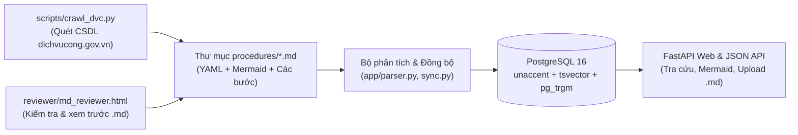

# Cổng Tra cứu Quy trình Thủ tục Hành chính Công Việt Nam

Ứng dụng web Python (**FastAPI + Jinja2 + Mermaid.js + PostgreSQL**) giúp tra cứu nhanh quy trình thủ tục hành chính công theo từng bước ngắn gọn, hiển thị sơ đồ Mermaid trực quan từ file Markdown và liên kết thẳng tới trang nộp hồ sơ trực tuyến chính thức trên [Cổng Dịch vụ công Quốc gia](https://vpcp.dichvucong.gov.vn/p/home/dvc-trang-chu.html) và cổng các Bộ, ngành.

## Kiến trúc tổng quan

## Chạy nhanh 1 lệnh

- **Windows (Command Prompt / Batch)**: `run_develop.bat` (hoặc `run_develop.bat --sqlite` nếu chưa bật Docker)
- **Windows (PowerShell)**: `.\run_develop.ps1` (hoặc `.\run_develop.ps1 -LocalSqlite` nếu chưa bật Docker)
- **macOS / Linux**: `chmod +x run_develop.sh && ./run_develop.sh` (hoặc `./run_develop.sh --sqlite`)
- **Docker Compose (Full stack + PostgreSQL 16)**: `docker compose up --build`

Sau khi khởi động, truy cập `http://127.0.0.1:8000` (hoặc `http://localhost:8000` với Docker).

## Mục lục tài liệu hướng dẫn (`docs/`)

Toàn bộ hướng dẫn chi tiết được tổ chức theo từng chủ đề trong thư mục `docs/`:

| STT | Tài liệu | Nội dung chính |
|---|---|---|
| 01 | [Cài đặt & Chạy môi trường Develop](docs/01-cai-dat-va-chay-dev.md) | Chạy `run_develop.ps1` / `run_develop.sh`, Docker Compose, cấu hình `.env`, xử lý lỗi thường gặp |
| 02 | [Chuẩn file Markdown, Mermaid & Trình duyệt Review](docs/02-cau-truc-file-markdown-va-mermaid.md) | Cấu trúc YAML frontmatter, cú pháp Mermaid, quy ước trích xuất từng bước, dùng `reviewer/md_reviewer.html` |
| 03 | [Cơ sở dữ liệu PostgreSQL & Tối ưu tìm kiếm](docs/03-database-postgres-va-tim-kiem.md) | Schema `db/schema.sql`, `unaccent`, `tsvector` trọng số A/B/C/D, `pg_trgm`, fallback SQLite |
| 04 | [Cập nhật mở & Thu thập toàn bộ TTHC Quốc gia](docs/04-thu-thap-va-dong-bo-du-lieu.md) | 3 cách nạp file `.md` mới, chạy `scripts/sync_md.py` và quét hàng nghìn thủ tục bằng `scripts/crawl_dvc.py` |
| 05 | [Tài liệu REST API, Kiến trúc mã nguồn & Kiểm thử](docs/05-api-va-kiem-thu.md) | Danh sách endpoints `/api/*`, cấu trúc thư mục `app/`, cách chạy bộ test `tests/test_app.py` |

## Dữ liệu sẵn có

- **30 thủ tục hành chính công đã xác minh** nằm trong `procedures/` (phủ Bộ Công an, Bộ Tư pháp, Bộ Tài chính & Hải quan, Bộ Nội vụ, Bộ Khoa học & Công nghệ, Bộ Y tế, Bộ Nông nghiệp & Môi trường, Bộ Xây dựng, BHXH Việt Nam, EVN) kèm file mẫu `procedures/_template.md`.
- Công cụ mở rộng `scripts/crawl_dvc.py` cho phép thu thập thêm toàn bộ hàng nghìn thủ tục từ CSDL Quốc gia trên `dichvucong.gov.vn` khi chạy trên máy có Internet.
