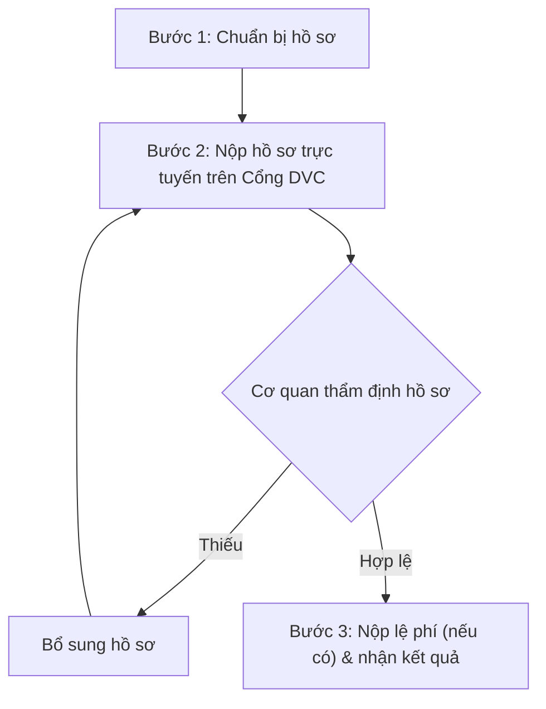

# Tên thủ tục hành chính mới

## Thông tin nhanh

| Hạng mục | Chi tiết |
|---|---|
| **Mã thủ tục** | `MA-THU-TUC` |
| **Cơ quan thực hiện** | Tên cơ quan |
| **Thời hạn giải quyết** | Số ngày làm việc |
| **Lệ phí** | Mức phí |

## Sơ đồ quy trình

## Các bước thực hiện ngắn gọn

1. **Bước 1 — Chuẩn bị hồ sơ**: Mô tả ngắn gọn giấy tờ cần thiết.
2. **Bước 2 — Nộp hồ sơ**: Hướng dẫn truy cập cổng dịch vụ công.
3. **Bước 3 — Nhận kết quả**: Thời gian và cách thức nhận kết quả.

## Hồ sơ & biểu mẫu cần chuẩn bị

- Giấy tờ 1 (Mẫu số ...)
- Giấy tờ 2

## Liên kết trang gốc & nộp hồ sơ trực tuyến

- [Chi tiết thủ tục trên Cổng Dịch vụ công Quốc gia](https://dichvucong.gov.vn)
