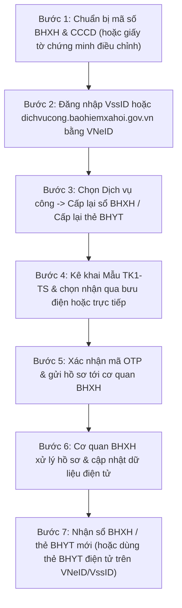

# Cấp lại, đổi, điều chỉnh thông tin trên sổ BHXH, thẻ BHYT

## Thông tin nhanh

| Hạng mục | Chi tiết |
|---|---|
| **Mã thủ tục** | `3940` (Sổ BHXH & Thẻ BHYT) / `1.002522` (Cấp lại thẻ BHYT) |
| **Cơ quan thực hiện** | Cơ quan Bảo hiểm xã hội Việt Nam |
| **Thời hạn giải quyết** | **07 ngày làm việc** đối với cấp lại thẻ BHYT (vẫn hưởng quyền lợi BHYT trong thời gian chờ) |
| **Lệ phí** | **Miễn lệ phí** |
| **Biểu mẫu chính** | Tờ khai tham gia, điều chỉnh thông tin BHXH, BHYT (**Mẫu TK1-TS**) |

## Sơ đồ quy trình

## Các bước thực hiện ngắn gọn

1. **Bước 1 — Đăng nhập**: Truy cập [Cổng Dịch vụ công BHXH Việt Nam](https://dichvucong.baohiemxahoi.gov.vn) hoặc ứng dụng **VssID**, đăng nhập bằng tài khoản VNeID hoặc mã số BHXH.
2. **Bước 2 — Chọn dịch vụ công**: Chọn dịch vụ tương ứng: *Cấp lại sổ BHXH không thay đổi thông tin*, *Cấp lại thẻ BHYT do hỏng/mất*, hoặc *Điều chỉnh thông tin nhân thân*.
3. **Bước 3 — Điền tờ khai TK1-TS**: Kiểm tra thông tin cá nhân tự động điền, đính kèm ảnh CCCD/giấy tờ chứng minh (nếu điều chỉnh họ tên, ngày sinh, giới tính).
4. **Bước 4 — Chọn hình thức nhận & gửi**: Chọn nhận kết quả trực tiếp tại Bộ phận Một cửa cơ quan BHXH hoặc qua dịch vụ bưu chính, nhập mã OTP xác nhận gửi hồ sơ.
5. **Bước 5 — Sử dụng & nhận kết quả**: Trong thời gian chờ cấp lại thẻ BHYT giấy, bạn vẫn được hưởng đầy đủ quyền lợi khám chữa bệnh (có thể xuất trình CCCD gắn chip hoặc hình ảnh thẻ BHYT trên VssID/VNeID).

## Hồ sơ & biểu mẫu cần chuẩn bị

- **Tờ khai tham gia, điều chỉnh thông tin BHXH, BHYT (Mẫu TK1-TS)**.
- **Các sổ BHXH cũ** (nếu thực hiện thủ tục gộp sổ BHXH).
- **CCCD / Hộ chiếu** hoặc giấy tờ pháp lý chứng minh (nếu điều chỉnh thông tin nhân thân trên sổ BHXH, thẻ BHYT).

## Liên kết trang gốc & nộp hồ sơ trực tuyến

- [Chi tiết thủ tục cấp lại, đổi sổ BHXH & thẻ BHYT (`3940`) — Cổng DVC Quốc gia](https://vpcp.dichvucong.gov.vn/p/home/dvc-tthc-thu-tuc-hanh-chinh-chi-tiet.html?ma_thu_tuc=3940)
- [Chi tiết thủ tục cấp lại thẻ BHYT (`1.002522`) — Cổng DVC Quốc gia](https://vpcp.dichvucong.gov.vn/p/home/dvc-chi-tiet-thu-tuc-hanh-chinh.html?ma_thu_tuc=1.002522)
- [Nộp hồ sơ trực tuyến tại Cổng Dịch vụ công BHXH Việt Nam](https://dichvucong.baohiemxahoi.gov.vn)
