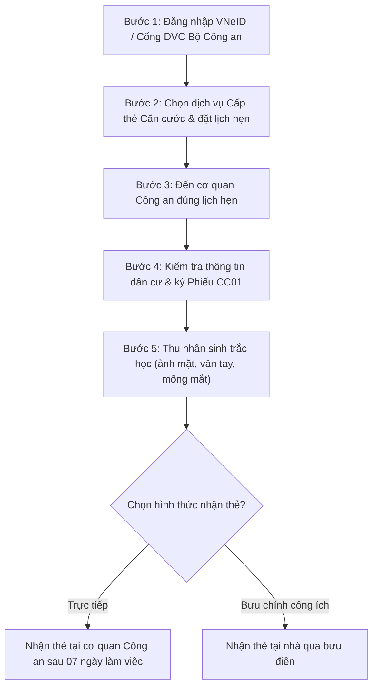

# Cấp thẻ Căn cước cho người từ đủ 14 tuổi trở lên

## Thông tin nhanh

| Hạng mục | Chi tiết |
|---|---|
| **Mã thủ tục** | `642` |
| **Cơ quan chủ quản** | Bộ Công an |
| **Thời hạn giải quyết** | **07 ngày làm việc** kể từ ngày nhận đủ hồ sơ hợp lệ |
| **Hình thức nộp** | Trực tiếp hoặc đặt lịch trực tuyến qua VNeID / Cổng DVC Bộ Công an |
| **Biểu mẫu chính** | Mẫu CC01, Mẫu DC01, Mẫu DC02 (Thông tư 17/2024/TT-BCA & Thông tư 53/2025/TT-BCA) |

## Sơ đồ quy trình

## Các bước thực hiện ngắn gọn

1. **Bước 1 — Kê khai & đặt lịch trực tuyến**: Đăng nhập [Cổng Dịch vụ công Bộ Công an](https://dichvucong.bocongan.gov.vn) hoặc ứng dụng VNeID bằng tài khoản định danh điện tử, chọn thủ tục cấp thẻ Căn cước và chọn ngày, địa điểm tiếp nhận.
2. **Bước 2 — Đối chiếu thông tin dân cư**: Đến cơ quan quản lý căn cước theo lịch hẹn. Cán bộ tra cứu thông tin công dân trong Cơ sở dữ liệu quốc gia về dân cư và in **Phiếu thu nhận thông tin căn cước (Mẫu CC01)** để bạn kiểm tra, ký xác nhận.
3. **Bước 3 — Thu nhận sinh trắc học**: Thực hiện chụp ảnh khuôn mặt, lấy dấu vân tay và thu nhận ảnh mống mắt theo hướng dẫn của cán bộ tiếp nhận.
4. **Bước 4 — Nhận giấy hẹn & trả kết quả**: Nhận giấy hẹn trả thẻ Căn cước (thời hạn **07 ngày làm việc**). Có thể đăng ký nhận trực tiếp hoặc chuyển phát tận nhà.

## Hồ sơ & biểu mẫu cần chuẩn bị

- **Phiếu thu nhận thông tin căn cước (Mẫu CC01)** ban hành kèm Thông tư 17/2024/TT-BCA (được tạo tự động tại cơ quan tiếp nhận).
- **Phiếu đề nghị giải quyết thủ tục về căn cước (Mẫu DC02)** nếu có yêu cầu liên quan.
- **Phiếu thu thập thông tin dân cư (Mẫu DC01)** (Thông tư 53/2025/TT-BCA) và giấy tờ pháp lý chứng minh nếu cần cập nhật, điều chỉnh thông tin chưa có trong CSDL quốc gia về dân cư.

## Liên kết trang gốc & nộp hồ sơ trực tuyến

- [Chi tiết thủ tục & tải mẫu trên Cổng Dịch vụ công Quốc gia](https://vpcp.dichvucong.gov.vn/p/home/dvc-tthc-thu-tuc-hanh-chinh-chi-tiet.html?ma_thu_tuc=642)
- [Nộp hồ sơ / Đặt lịch trực tuyến tại Cổng Dịch vụ công Bộ Công an](https://dichvucong.bocongan.gov.vn)

## Căn cứ pháp lý

- Luật Căn cước số `26/2023/QH15` (ngày 27/11/2023)
- Nghị định `70/2024/NĐ-CP` (ngày 25/06/2024)
- Thông tư `16/2024/TT-BCA`, `17/2024/TT-BCA`, `18/2024/TT-BCA` và `53/2025/TT-BCA` của Bộ Công an
