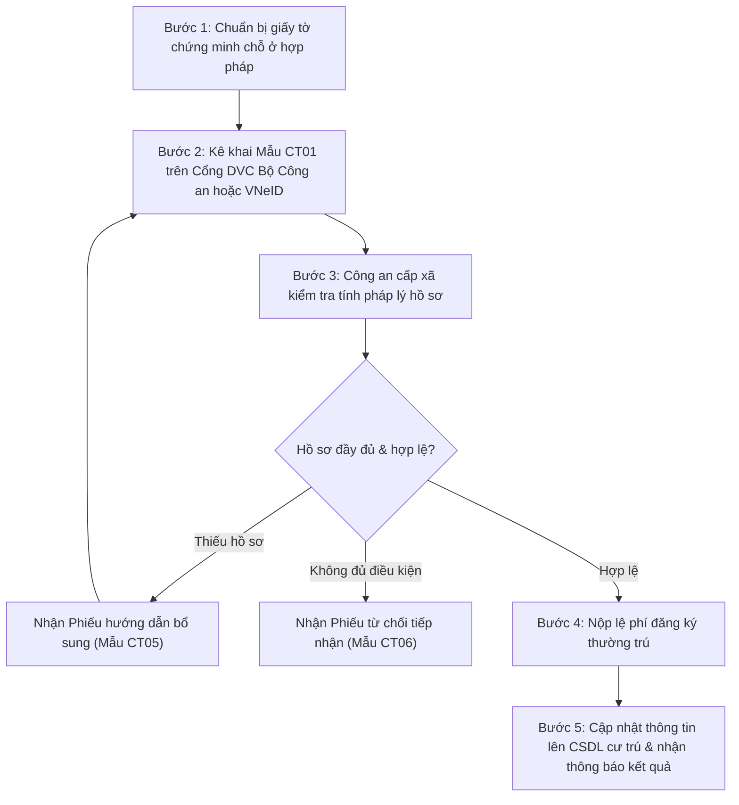

# Đăng ký thường trú

## Thông tin nhanh

| Hạng mục | Chi tiết |
|---|---|
| **Mã thủ tục** | `1.004222` |
| **Cơ quan thực hiện** | Công an cấp xã |
| **Hình thức nộp** | Trực tuyến (Cổng DVC Quốc gia, Cổng DVC Bộ Công an, VNeID) hoặc trực tiếp |
| **Biểu mẫu chính** | Tờ khai thay đổi thông tin cư trú (Mẫu CT01 / CT02 theo Thông tư 66/2023/TT-BCA) |

## Sơ đồ quy trình

## Các bước thực hiện ngắn gọn

1. **Bước 1 — Chuẩn bị hồ sơ**: Chuẩn bị giấy tờ chứng minh chỗ ở hợp pháp (sổ đỏ, hợp đồng mua bán/thuê nhà, văn bản đồng ý của chủ hộ/chủ sở hữu nếu nhập hộ).
2. **Bước 2 — Nộp hồ sơ**: Nộp trực tuyến qua [Cổng Dịch vụ công Bộ Công an](https://dichvucong.bocongan.gov.vn), ứng dụng VNeID, hoặc trực tiếp tại Công an cấp xã (giờ hành chính thứ 2 – sáng thứ 7).
3. **Bước 3 — Kiểm tra & thẩm định**: Công an cấp xã kiểm tra hồ sơ, khai thác dữ liệu cư trú. Nếu thiếu giấy tờ sẽ cấp **Phiếu hướng dẫn bổ sung (Mẫu CT05)**; nếu không đủ điều kiện cấp **Mẫu CT06**.
4. **Bước 4 — Nộp lệ phí**: Thanh toán lệ phí đăng ký thường trú trực tuyến hoặc tại nơi tiếp nhận.
5. **Bước 5 — Nhận kết quả**: Căn cứ ngày hẹn trên Phiếu tiếp nhận để nhận thông báo kết quả giải quyết (cập nhật trực tiếp trên CSDL quốc gia về dân cư và ứng dụng VNeID).

## Hồ sơ & biểu mẫu cần chuẩn bị

- **Tờ khai thay đổi thông tin về cư trú (Mẫu CT01)** (hoặc **Mẫu CT02** đối với người Việt Nam định cư ở nước ngoài theo Thông tư 66/2023/TT-BCA).
- **Giấy tờ, tài liệu chứng minh việc sở hữu chỗ ở hợp pháp** (hoặc chứng minh quan hệ nhân thân/đồng ý cho đăng ký thường trú).
- **Giấy giới thiệu của Thủ trưởng đơn vị** (nếu đăng ký tại đơn vị đóng quân trong Công an/Quân đội).

## Liên kết trang gốc & nộp hồ sơ trực tuyến

- [Chi tiết thủ tục & biểu mẫu trên Cổng Dịch vụ công Quốc gia](https://vpcp.dichvucong.gov.vn/p/home/dvc-chi-tiet-thu-tuc-nganh-doc.html?ma_thu_tuc=1.004222)
- [Nộp hồ sơ trực tuyến tại Cổng Dịch vụ công Bộ Công an](https://dichvucong.bocongan.gov.vn)

## Căn cứ pháp lý

- Luật Cư trú năm 2020
- Thông tư `66/2023/TT-BCA` của Bộ Công an quy định về biểu mẫu cư trú (CT01, CT02, CT05, CT06)
