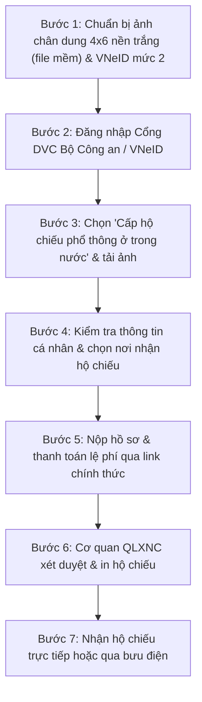

# Cấp hộ chiếu phổ thông ở trong nước

## Thông tin nhanh

| Hạng mục | Chi tiết |
|---|---|
| **Mã thủ tục** | `1.001456` (Cấp tỉnh) / `1.001471` (Cấp trung ương) |
| **Cơ quan thực hiện** | Phòng Quản lý xuất nhập cảnh Công an cấp tỉnh / Cục QLXNC |
| **Hình thức nộp** | Trực tuyến toàn trình qua VNeID mức 2 hoặc trực tiếp |
| **Lưu ý an toàn** | Chỉ nộp qua `dichvucong.gov.vn` hoặc `dichvucong.bocongan.gov.vn`, không chuyển tiền vào tài khoản cá nhân |

## Sơ đồ quy trình

## Các bước thực hiện ngắn gọn

1. **Bước 1 — Chuẩn bị ảnh & tài khoản**: Cần tài khoản **VNeID mức độ 2** và ảnh chân dung 4x6cm nền trắng, mặt nhìn thẳng, không đeo kính, định dạng `.jpg`.
2. **Bước 2 — Đăng nhập Cổng DVC**: Truy cập [Cổng Dịch vụ công Bộ Công an](https://dichvucong.bocongan.gov.vn) hoặc mở ứng dụng VNeID → mục **Nộp hồ sơ trực tuyến** → **Cấp hộ chiếu phổ thông ở trong nước**.
3. **Bước 3 — Khai tờ khai điện tử**: Tải ảnh chân dung, kiểm tra thông tin tự động điền từ CSDL dân cư, chọn loại hộ chiếu (gắn chip hoặc không gắn chip) và hình thức nhận kết quả.
4. **Bước 4 — Thanh toán lệ phí trực tuyến**: Sau khi cán bộ tiếp nhận xác nhận hồ sơ hợp lệ, hệ thống gửi đường dẫn thanh toán lệ phí qua tin nhắn/email chính thức.
5. **Bước 5 — Nhận hộ chiếu**: Theo dõi tiến độ xử lý bằng mã hồ sơ và nhận hộ chiếu tại Phòng QLXNC hoặc qua dịch vụ bưu chính.

## Hồ sơ & biểu mẫu cần chuẩn bị

- **Tờ khai đề nghị cấp hộ chiếu phổ thông** (khai trực tuyến trên Cổng DVC).
- **Ảnh chân dung 4x6cm nền trắng** (chụp không quá 06 tháng).
- **Hộ chiếu phổ thông cấp lần gần nhất** (nếu còn giá trị sử dụng, trường hợp cấp lại do hết trang/hỏng).

## Liên kết trang gốc & nộp hồ sơ trực tuyến

- [Chi tiết thủ tục cấp tỉnh trên Cổng Dịch vụ công Quốc gia (`1.001456`)](https://vpcp.dichvucong.gov.vn/p/home/dvc-chi-tiet-thu-tuc-nganh-doc.html?ma_thu_tuc=1.001456)
- [Chi tiết thủ tục cấp trung ương trên Cổng Dịch vụ công Quốc gia (`1.001471`)](https://vpcp.dichvucong.gov.vn/p/home/dvc-chi-tiet-thu-tuc-nganh-doc.html?ma_thu_tuc=1.001471)
- [Nộp hồ sơ trực tuyến tại Cổng Dịch vụ công Bộ Công an](https://dichvucong.bocongan.gov.vn)
