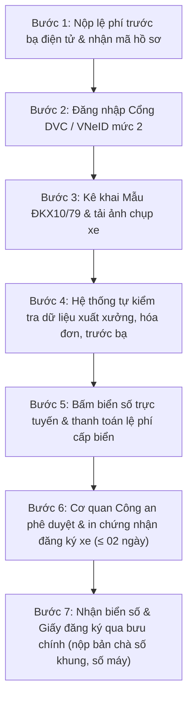

# Đăng ký xe lần đầu trực tuyến toàn trình (xe sản xuất, lắp ráp trong nước)

## Thông tin nhanh

| Hạng mục | Chi tiết |
|---|---|
| **Mã thủ tục** | `1.012575` (chi tiết `342680`) |
| **Cơ quan thực hiện** | Phòng CSGT Công an cấp tỉnh / Công an cấp xã được phân cấp |
| **Thời hạn giải quyết** | **Không quá 02 ngày làm việc** |
| **Hình thức nộp** | Trực tuyến toàn trình qua VNeID mức 2 / Cổng DVC Bộ Công an |
| **Biểu mẫu chính** | Giấy khai đăng ký xe (Mẫu ĐKX10/79 theo Thông tư 13/2025/TT-BCA) |

## Sơ đồ quy trình

## Các bước thực hiện ngắn gọn

1. **Bước 1 — Hoàn thành lệ phí trước bạ**: Kê khai và nộp lệ phí trước bạ điện tử để có mã hồ sơ trước bạ đồng bộ với hệ thống đăng ký xe.
2. **Bước 2 — Kê khai trực tuyến**: Đăng nhập VNeID mức độ 2 trên [Cổng Dịch vụ công Bộ Công an](https://dichvucong.bocongan.gov.vn) hoặc ứng dụng VNeID, chọn **Đăng ký xe lần đầu trực tuyến toàn trình** và điền **Mẫu ĐKX10/79**.
3. **Bước 3 — Đối chiếu dữ liệu điện tử**: Hệ thống tự động truy xuất dữ liệu điện tử của Phiếu kiểm tra chất lượng xuất xưởng, Hóa đơn điện tử và chứng từ lệ phí trước bạ.
4. **Bước 4 — Bấm biển số & nộp lệ phí**: Thực hiện bấm chọn biển số trực tuyến trên hệ thống và thanh toán lệ phí cấp biển số qua cổng thanh toán.
5. **Bước 5 — Nhận kết quả**: Trong **02 ngày làm việc**, cơ quan đăng ký xe gửi Chứng nhận đăng ký xe và biển số qua dịch vụ bưu chính công ích. Chủ xe giao lại Phiếu kiểm tra chất lượng xuất xưởng (có dán bản chà số máy, số khung) cho nhân viên bưu chính chuyển về cơ quan Công an.

## Hồ sơ & biểu mẫu cần chuẩn bị

- **Giấy khai đăng ký xe (Mẫu ĐKX10/79)** ban hành kèm Thông tư 13/2025/TT-BCA.
- **Tài khoản VNeID mức độ 2** của chủ xe.
- **Dữ liệu điện tử**: Phiếu kiểm tra chất lượng xuất xưởng, Hóa đơn điện tử, chứng từ nộp lệ phí trước bạ.
- **Bản chính Phiếu kiểm tra chất lượng xuất xưởng** (có dán bản chà số máy, số khung đóng dấu giáp lai của cơ sở sản xuất) để bàn giao khi nhận biển số.

## Liên kết trang gốc & nộp hồ sơ trực tuyến

- [Chi tiết thủ tục & tải mẫu ĐKX10/79 trên Cổng DVC Quốc gia](https://vpcp.dichvucong.gov.vn/p/home/dvc-tthc-thu-tuc-hanh-chinh-chi-tiet.html?ma_thu_tuc=342680)
- [Chi tiết thủ tục ngành dọc (`1.012575`)](https://vpcp.dichvucong.gov.vn/p/home/dvc-chi-tiet-thu-tuc-nganh-doc.html?ma_thu_tuc=1.012575)
- [Nộp hồ sơ trực tuyến tại Cổng Dịch vụ công Bộ Công an](https://dichvucong.bocongan.gov.vn)

## Căn cứ pháp lý

- Luật Trật tự, an toàn giao thông đường bộ số `36/2024/QH15`
- Thông tư `79/2024/TT-BCA` và Thông tư `13/2025/TT-BCA` của Bộ Công an
- Thông tư `60/2023/TT-BTC` và Thông tư `06/2025/TT-BTC` của Bộ Tài chính
