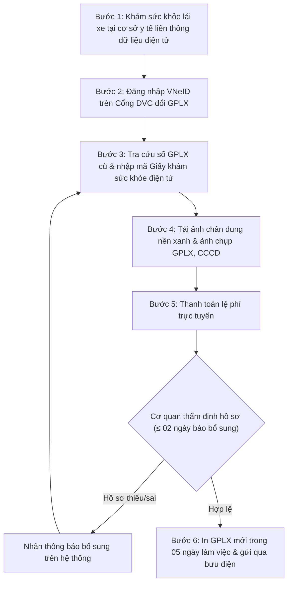

# Đổi Giấy phép lái xe trực tuyến

## Thông tin nhanh

| Hạng mục | Chi tiết |
|---|---|
| **Mã thủ tục** | `1.002809` |
| **Thời hạn giải quyết** | **05 ngày làm việc** kể từ ngày nhận đủ hồ sơ đúng quy định |
| **Điều kiện tiên quyết** | Có Giấy khám sức khỏe điện tử, không có vi phạm giao thông chưa xử lý |
| **Hình thức nộp** | Trực tuyến toàn trình hoặc trực tiếp |

## Sơ đồ quy trình

## Các bước thực hiện ngắn gọn

1. **Bước 1 — Khám sức khỏe điện tử**: Khám sức khỏe lái xe tại cơ sở y tế đã liên thông dữ liệu với Cổng Dịch vụ công Quốc gia để lấy **Mã giấy khám sức khỏe điện tử**.
2. **Bước 2 — Đăng nhập Cổng DVC đổi GPLX**: Truy cập [Cổng DVC cấp đổi GPLX - Cục CSGT](https://dvc-gplx.csgt.bocongan.gov.vn) (hoặc tra cứu qua [Cổng DVC Quốc gia](https://vpcp.dichvucong.gov.vn/p/home/dvc-chi-tiet-thu-tuc-hanh-chinh.html?ma_thu_tuc=1.002809)), đăng nhập bằng tài khoản VNeID.
3. **Bước 3 — Kê khai & tải hồ sơ**: Nhập số GPLX cần đổi để hệ thống kiểm tra dữ liệu và tra cứu vi phạm giao thông, nhập mã Giấy khám sức khỏe điện tử, tải ảnh chân dung và ảnh chụp GPLX/CCCD.
4. **Bước 4 — Thanh toán lệ phí**: Thanh toán lệ phí cấp đổi trực tuyến và chọn địa chỉ nhận GPLX mới qua bưu điện.
5. **Bước 5 — Nhận GPLX mới**: Trong vòng **05 ngày làm việc** kể từ khi hồ sơ hợp lệ, GPLX mới được chuyển tận tay đúng cá nhân đề nghị đổi.

## Hồ sơ & biểu mẫu cần chuẩn bị

- **Tài khoản định danh điện tử VNeID**.
- **Mã Giấy khám sức khỏe lái xe điện tử** (hoặc bản chứng thực điện tử).
- **Ảnh chân dung** chuẩn nền xanh/trắng theo yêu cầu trên biểu mẫu trực tuyến.
- **Bản chụp GPLX hiện tại** và thẻ Căn cước/CCCD (hoặc Hộ chiếu còn hạn đối với người nước ngoài).

## Liên kết trang gốc & nộp hồ sơ trực tuyến

- [Chi tiết thủ tục trên Cổng Dịch vụ công Quốc gia (`1.002809`)](https://vpcp.dichvucong.gov.vn/p/home/dvc-chi-tiet-thu-tuc-hanh-chinh.html?ma_thu_tuc=1.002809)
- [Nộp hồ sơ đổi GPLX trực tuyến — Cổng Cục CSGT](https://dvc-gplx.csgt.bocongan.gov.vn)
- [Cổng dịch vụ công GPLX trực tuyến (cổng tham chiếu)](https://dvc4.gplx.gov.vn/p/home/dvc-trang-chu.html)
