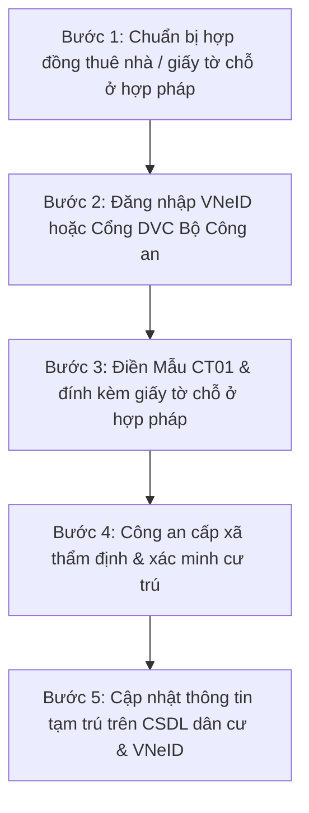

# Đăng ký tạm trú

## Thông tin nhanh

| Hạng mục | Chi tiết |
|---|---|
| **Mã thủ tục** | `1.004194` (chi tiết `5974`) |
| **Cơ quan thực hiện** | Công an cấp xã nơi dự kiến tạm trú |
| **Biểu mẫu chính** | Tờ khai thay đổi thông tin cư trú (**Mẫu CT01**) |

## Sơ đồ quy trình

## Các bước thực hiện ngắn gọn

1. **Bước 1 — Chuẩn bị giấy tờ**: Chụp hợp đồng thuê/mượn/ở nhờ hoặc giấy tờ chứng minh chỗ ở hợp pháp (trường hợp người chưa thành niên phải có ý kiến đồng ý của cha, mẹ hoặc người giám hộ trong tờ khai).
2. **Bước 2 — Kê khai trực tuyến**: Đăng nhập [Cổng Dịch vụ công Bộ Công an](https://dichvucong.bocongan.gov.vn) hoặc VNeID, chọn thủ tục **Đăng ký tạm trú** và điền **Mẫu CT01**.
3. **Bước 3 — Nộp lệ phí & chờ thẩm định**: Nộp lệ phí trực tuyến (nếu có) và theo dõi trạng thái hồ sơ.
4. **Bước 4 — Nhận kết quả**: Thông tin tạm trú được cập nhật tự động trên Cơ sở dữ liệu quốc gia về cư trú và hiển thị trên VNeID.

## Hồ sơ & biểu mẫu cần chuẩn bị

- **Tờ khai thay đổi thông tin cư trú (Mẫu CT01)**.
- **Giấy tờ, tài liệu chứng minh chỗ ở hợp pháp** (hợp đồng thuê nhà, sổ đỏ, văn bản đồng ý của chủ hộ/chủ sở hữu).

## Liên kết trang gốc & nộp hồ sơ trực tuyến

- [Chi tiết thủ tục Đăng ký tạm trú (`1.004194`) — Cổng DVC Quốc gia](https://vpcp.dichvucong.gov.vn/p/home/dvc-chi-tiet-thu-tuc-nganh-doc.html?ma_thu_tuc=1.004194)
- [Chi tiết biểu mẫu (`5974`) — Cổng DVC Quốc gia](https://vpcp.dichvucong.gov.vn/p/home/dvc-tthc-thu-tuc-hanh-chinh-chi-tiet.html?ma_thu_tuc=5974)
- [Nộp hồ sơ trực tuyến tại Cổng Dịch vụ công Bộ Công an](https://dichvucong.bocongan.gov.vn)
