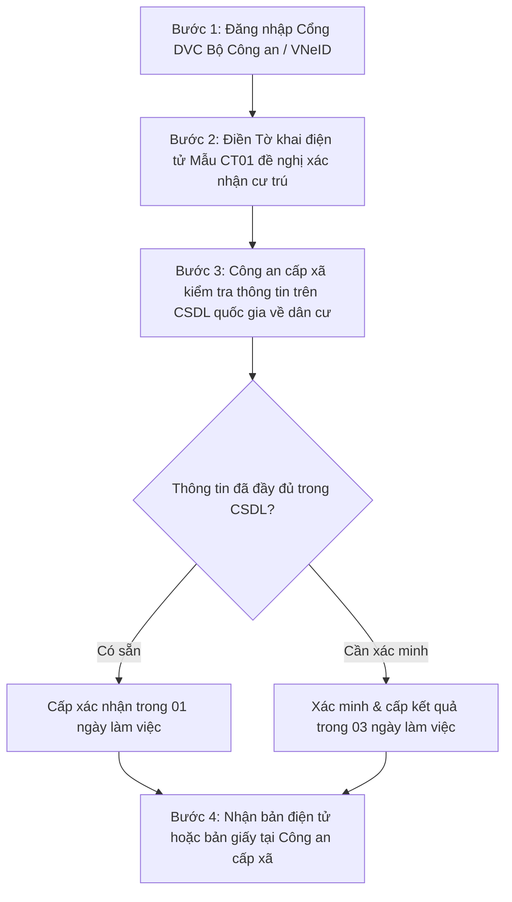

# Xác nhận thông tin về cư trú (Mẫu CT07)

## Thông tin nhanh

| Hạng mục | Chi tiết |
|---|---|
| **Mã thủ tục** | `1.010041` |
| **Cơ quan thực hiện** | Công an cấp xã |
| **Thời hạn giải quyết** | **01 ngày làm việc** (có trong CSDL dân cư) hoặc **03 ngày làm việc** (cần xác minh) |
| **Biểu mẫu chính** | Tờ khai **Mẫu CT01** (Thông tư 66/2023/TT-BCA) |

## Sơ đồ quy trình

## Các bước thực hiện ngắn gọn

1. **Bước 1 — Kê khai trực tuyến**: Đăng nhập [Cổng Dịch vụ công Bộ Công an](https://dichvucong.bocongan.gov.vn) hoặc VNeID, chọn **Xác nhận thông tin về cư trú** và điền biểu mẫu điện tử **Mẫu CT01**.
2. **Bước 2 — Tiếp nhận & kiểm tra**: Công an cấp xã kiểm tra tính pháp lý hồ sơ, cấp Phiếu tiếp nhận hẹn trả (**Mẫu CT04**) hoặc hướng dẫn bổ sung (**Mẫu CT05**).
3. **Bước 3 — Nhận kết quả**: Nhận Giấy xác nhận thông tin về cư trú bản điện tử hoặc bản giấy trong **01 ngày làm việc** (tối đa **03 ngày làm việc** nếu cần xác minh).

## Hồ sơ & biểu mẫu cần chuẩn bị

- **Tờ khai thay đổi thông tin cư trú (Mẫu CT01)** ban hành kèm Thông tư `66/2023/TT-BCA` (khai trực tuyến theo biểu mẫu điện tử).

## Liên kết trang gốc & nộp hồ sơ trực tuyến

- [Chi tiết thủ tục Xác nhận thông tin về cư trú (`1.010041`) — Cổng DVC Quốc gia](https://vpcp.dichvucong.gov.vn/p/home/dvc-chi-tiet-thu-tuc-nganh-doc.html?ma_thu_tuc=1.010041)
- [Nộp hồ sơ trực tuyến tại Cổng Dịch vụ công Bộ Công an](https://dichvucong.bocongan.gov.vn)
