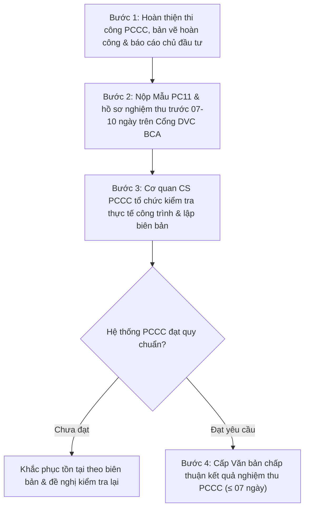

# Nghiệm thu về phòng cháy và chữa cháy (PCCC)

## Thông tin nhanh

| Hạng mục | Chi tiết |
|---|---|
| **Mã thủ tục** | `1.000858` (chi tiết `1271`, QĐ `5461/QĐ-BCA-C07`) |
| **Cơ quan thực hiện** | Cục Cảnh sát PCCC và CNCH / Phòng Cảnh sát PCCC Công an cấp tỉnh |
| **Thời hạn giải quyết** | **07–10 ngày làm việc** kiểm tra nghiệm thu + **07 ngày làm việc** ra văn bản chấp thuận |
| **Biểu mẫu chính** | Văn bản đề nghị kiểm tra kết quả nghiệm thu về PCCC (**Mẫu số PC11**) |

## Sơ đồ quy trình

## Các bước thực hiện ngắn gọn

1. **Bước 1 — Hoàn thiện hồ sơ hoàn công**: Tổng hợp Báo cáo kết quả thi công PCCC, bản vẽ hoàn công hệ thống PCCC phù hợp thiết kế đã duyệt và các biên bản nghiệm thu hạng mục.
2. **Bước 2 — Nộp hồ sơ đề nghị**: Nộp **Mẫu PC11** kèm hồ sơ qua [Cổng Dịch vụ công Bộ Công an](https://dichvucong.bocongan.gov.vn) hoặc Bộ phận Một cửa cơ quan PCCC tối thiểu 07 ngày làm việc (10 ngày với dự án nhóm A) trước ngày dự kiến kiểm tra.
3. **Bước 3 — Kiểm tra thực tế**: Cơ quan Cảnh sát PCCC tổ chức kiểm tra hiện trường, thử nghiệm hệ thống báo cháy/chữa cháy và lập biên bản.
4. **Bước 4 — Nhận Văn bản chấp thuận**: Trong **07 ngày làm việc** kể từ khi thông qua biên bản đạt yêu cầu, nhận Văn bản chấp thuận kết quả nghiệm thu PCCC.

## Hồ sơ & biểu mẫu cần chuẩn bị

- **Văn bản đề nghị kiểm tra kết quả nghiệm thu về PCCC (Mẫu số PC11)** (01 bản chính).
- **Báo cáo của chủ đầu tư** về tình hình thi công, kiểm tra, kiểm định, thử nghiệm hệ thống PCCC (01 bản chính).
- **Bản vẽ hoàn công hệ thống PCCC** và **Văn bản nghiệm thu hoàn thành** các hạng mục liên quan.

## Liên kết trang gốc & nộp hồ sơ trực tuyến

- [Chi tiết thủ tục Nghiệm thu về PCCC (`1.000858` / `1271`) — Cổng DVC Quốc gia](https://vpcp.dichvucong.gov.vn/p/home/dvc-tthc-thu-tuc-hanh-chinh-chi-tiet.html?ma_thu_tuc=1271)
- [Nộp hồ sơ trực tuyến tại Cổng Dịch vụ công Bộ Công an](https://dichvucong.bocongan.gov.vn)
