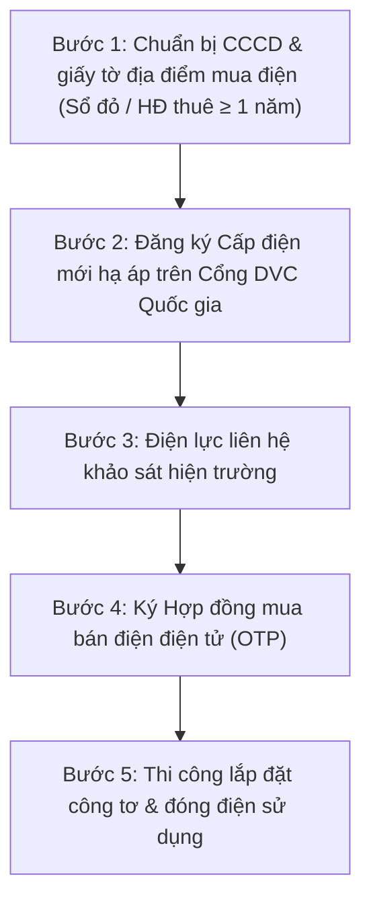

# Cấp điện mới từ lưới điện hạ áp

## Thông tin nhanh

| Hạng mục | Chi tiết |
|---|---|
| **Mã thủ tục** | `7603` |
| **Đơn vị thực hiện** | Công ty Điện lực / Điện lực địa phương (EVN) |
| **Hình thức nộp** | Trực tuyến toàn trình trên Cổng Dịch vụ công Quốc gia |

## Sơ đồ quy trình

## Các bước thực hiện ngắn gọn

1. **Bước 1 — Chuẩn bị giấy tờ**: Chụp thẻ CCCD/Hộ chiếu và 01 loại giấy tờ xác định chủ thể địa điểm mua điện (Sổ đỏ, hợp đồng mua bán nhà, hợp đồng thuê nhà từ 01 năm trở lên có đồng ý của chủ sở hữu, hoặc Giấy CN ĐKDN).
2. **Bước 2 — Gửi yêu cầu trực tuyến**: Truy cập [Cổng Dịch vụ công Quốc gia (`7603`)](https://vpcp.dichvucong.gov.vn/p/home/dvc-tthc-thu-tuc-hanh-chinh-chi-tiet.html?ma_thu_tuc=7603), chọn mục đích sử dụng điện (sinh hoạt / ngoài sinh hoạt) và tải hồ sơ.
3. **Bước 3 — Khảo sát & ký hợp đồng điện tử**: Nhân viên điện lực khảo sát hiện trường và gửi Hợp đồng mua bán điện điện tử để bạn xác nhận bằng mã OTP.
4. **Bước 4 — Lắp công tơ & đóng điện**: Điện lực lắp đặt công tơ, nghiệm thu và cấp điện.

## Hồ sơ & biểu mẫu cần chuẩn bị

- **Giấy tờ tùy thân** (CCCD/Hộ chiếu/Giấy xác nhận nhân thân).
- **Giấy tờ xác định chủ thể hợp đồng mua bán điện**: Sổ đỏ, Hợp đồng mua bán/thuê nhà (từ 01 năm trở lên + đồng ý chủ sở hữu), hoặc Giấy chứng nhận đăng ký doanh nghiệp/hộ kinh doanh.

## Liên kết trang gốc & nộp hồ sơ trực tuyến

- [Chi tiết thủ tục & đăng ký Cấp điện mới từ lưới điện hạ áp (`7603`)](https://vpcp.dichvucong.gov.vn/p/home/dvc-tthc-thu-tuc-hanh-chinh-chi-tiet.html?ma_thu_tuc=7603)
