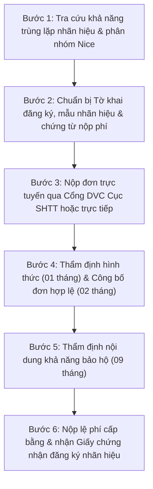

# Thủ tục đăng ký bảo hộ nhãn hiệu (Thương hiệu / Logo)

## Thông tin nhanh

| Hạng mục | Chi tiết |
|---|---|
| **Mã thủ tục** | `431425` |
| **Cơ quan thực hiện** | Cục Sở hữu trí tuệ (Bộ Khoa học và Công nghệ) |
| **Hiệu lực bảo hộ** | **10 năm** kể từ ngày nộp đơn, có thể gia hạn nhiều lần liên tiếp |

## Sơ đồ quy trình

## Các bước thực hiện ngắn gọn

1. **Bước 1 — Tra cứu & phân nhóm**: Tra cứu sơ bộ khả năng trùng/tương tự nhãn hiệu và phân loại danh mục sản phẩm/dịch vụ theo bảng phân loại quốc tế Nice.
2. **Bước 2 — Soạn hồ sơ & nộp đơn**: Chuẩn bị Tờ khai đăng ký nhãn hiệu, mẫu nhãn hiệu (kích thước tối đa 80x80mm) và nộp trực tuyến qua Cổng DVC hoặc trực tiếp tại Cục Sở hữu trí tuệ.
3. **Bước 3 — Theo dõi thẩm định**: Đơn lần lượt trải qua thẩm định hình thức, công bố trên Công báo SHCN và thẩm định nội dung.
4. **Bước 4 — Nhận Văn bằng bảo hộ**: Khi có Thông báo dự định cấp văn bằng, nộp lệ phí cấp bằng và nhận Giấy chứng nhận đăng ký nhãn hiệu.

## Hồ sơ & biểu mẫu cần chuẩn bị

- **Tờ khai đăng ký nhãn hiệu** (02 bản nếu nộp giấy, hoặc khai trực tuyến).
- **Mẫu nhãn hiệu** và danh mục hàng hóa/dịch vụ mang nhãn hiệu.
- **Chứng từ nộp phí, lệ phí** đăng ký nhãn hiệu.
- **Giấy ủy quyền** (nếu nộp đơn thông qua tổ chức đại diện sở hữu công nghiệp).

## Liên kết trang gốc & nộp hồ sơ trực tuyến

- [Chi tiết thủ tục Đăng ký nhãn hiệu (`431425`) — Cổng DVC Quốc gia](https://vpcp.dichvucong.gov.vn/p/home/dvc-tthc-thu-tuc-hanh-chinh-chi-tiet.html?ma_thu_tuc=431425&open_popup=1)
