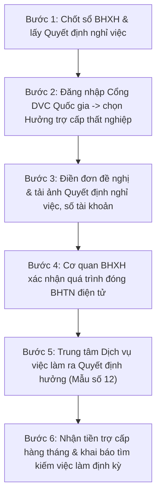

# Giải quyết hưởng trợ cấp thất nghiệp

## Thông tin nhanh

| Hạng mục | Chi tiết |
|---|---|
| **Mã thủ tục** | `424973` |
| **Thời hạn nộp hồ sơ** | Trong vòng **03 tháng** kể từ ngày chấm dứt hợp đồng lao động |
| **Biểu mẫu / Căn cứ** | Quyết định hưởng trợ cấp thất nghiệp (**Mẫu số 12**, Nghị định `374/2025/NĐ-CP`) |
| **Lệ phí** | **Miễn lệ phí** |

## Sơ đồ quy trình

## Các bước thực hiện ngắn gọn

1. **Bước 1 — Chuẩn bị giấy tờ nghỉ việc**: Yêu cầu công ty cũ chốt sổ BHXH và cấp Quyết định thôi việc / Thỏa thuận chấm dứt hợp đồng lao động.
2. **Bước 2 — Nộp hồ sơ trực tuyến**: Đăng nhập [Cổng Dịch vụ công Quốc gia (`424973`)](https://vpcp.dichvucong.gov.vn/p/home/dvc-tthc-thu-tuc-hanh-chinh-chi-tiet.html?ma_thu_tuc=424973&open_popup=1) bằng VNeID, chọn Trung tâm Dịch vụ việc làm nơi muốn nhận trợ cấp, tải bản chụp Quyết định nghỉ việc và điền số tài khoản ngân hàng.
3. **Bước 3 — Xác nhận dữ liệu BHXH**: Hệ thống tự động gửi sang cơ quan BHXH để xác nhận thời gian đóng bảo hiểm thất nghiệp.
4. **Bước 4 — Nhận Quyết định & tiền trợ cấp**: Nhận Quyết định hưởng trợ cấp thất nghiệp (**Mẫu số 12** theo Nghị định 374/2025/NĐ-CP) và nhớ thực hiện **thông báo tìm kiếm việc làm hàng tháng** đúng lịch để không bị tạm dừng trợ cấp.

## Hồ sơ & biểu mẫu cần chuẩn bị

- **Đề nghị hưởng trợ cấp thất nghiệp** (khai trực tuyến trên Cổng DVC Quốc gia).
- **Bản chính hoặc bản sao chứng thực Quyết định thôi việc** / Hợp đồng lao động hết hạn / Thỏa thuận chấm dứt HĐLĐ.
- **Sổ BHXH đã chốt** (dữ liệu điện tử đồng bộ qua BHXH).

## Liên kết trang gốc & nộp hồ sơ trực tuyến

- [Chi tiết thủ tục Hưởng trợ cấp thất nghiệp (`424973`) — Cổng DVC Quốc gia](https://vpcp.dichvucong.gov.vn/p/home/dvc-tthc-thu-tuc-hanh-chinh-chi-tiet.html?ma_thu_tuc=424973&open_popup=1)
