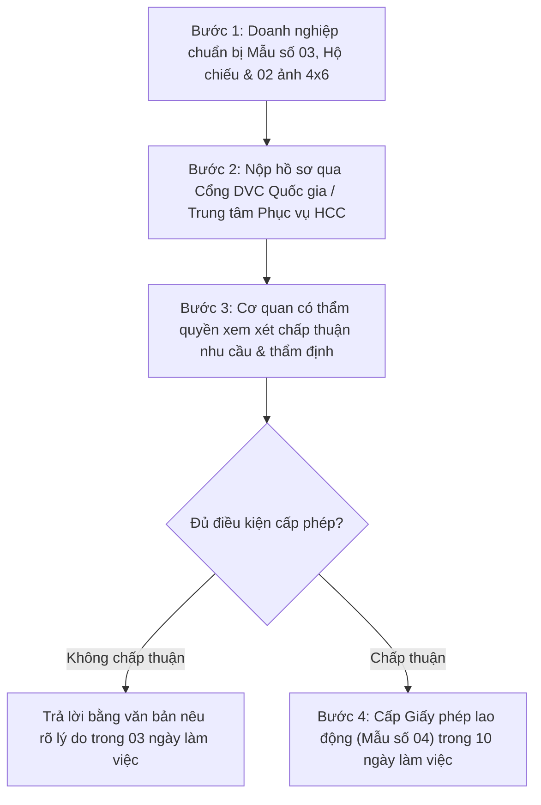

# Cấp và cấp lại Giấy phép lao động cho người nước ngoài tại Việt Nam

## Thông tin nhanh

| Hạng mục | Chi tiết |
|---|---|
| **Mã thủ tục** | `1.014199` (Cấp mới) & `411160` (Cấp lại) |
| **Thời hạn giải quyết** | **10 ngày làm việc** (cấp mới); **03 ngày làm việc** (cấp lại hoặc văn bản trả lời không chấp thuận) |
| **Biểu mẫu / Căn cứ** | Mẫu số `03` & Mẫu số `04` ban hành kèm Nghị định `219/2025/NĐ-CP` |

## Sơ đồ quy trình

## Các bước thực hiện ngắn gọn

1. **Bước 1 — Chuẩn bị hồ sơ**: Người sử dụng lao động lập văn bản báo cáo giải trình nhu cầu và đề nghị cấp giấy phép lao động (**Mẫu số 03**, Nghị định 219/2025/NĐ-CP), kèm hộ chiếu còn hạn và 02 ảnh màu 4x6cm nền trắng.
2. **Bước 2 — Nộp hồ sơ**: Nộp trực tuyến qua [Cổng Dịch vụ công Quốc gia (`1.014199`)](https://vpcp.dichvucong.gov.vn/p/home/dvc-chi-tiet-thu-tuc-dung-chung.html?ma_thu_tuc=1.014199) hoặc tại Trung tâm Phục vụ hành chính công địa phương.
3. **Bước 3 — Thẩm định & trả kết quả**: Trong **10 ngày làm việc** (hoặc **03 ngày làm việc** đối với thủ tục cấp lại), cơ quan có thẩm quyền cấp Giấy phép lao động theo **Mẫu số 04**.

## Hồ sơ & biểu mẫu cần chuẩn bị

- **Văn bản giải trình nhu cầu & đề nghị cấp/cấp lại GPLĐ (Mẫu số 03)** theo Nghị định `219/2025/NĐ-CP`.
- **Hộ chiếu còn thời hạn** và **02 ảnh màu 4x6cm nền trắng** (không đeo kính).
- **Giấy tờ chứng minh thay đổi thông tin** (họ tên, quốc tịch, số hộ chiếu, tên doanh nghiệp — đối với trường hợp cấp lại).

## Liên kết trang gốc & nộp hồ sơ trực tuyến

- [Thủ tục Cấp mới Giấy phép lao động (`1.014199`) — Cổng DVC Quốc gia](https://vpcp.dichvucong.gov.vn/p/home/dvc-chi-tiet-thu-tuc-dung-chung.html?ma_thu_tuc=1.014199)
- [Thủ tục Cấp lại Giấy phép lao động (`411160`) — Cổng DVC Quốc gia](https://vpcp.dichvucong.gov.vn/p/home/dvc-tthc-thu-tuc-hanh-chinh-chi-tiet.html?ma_thu_tuc=411160&open_popup=1)
