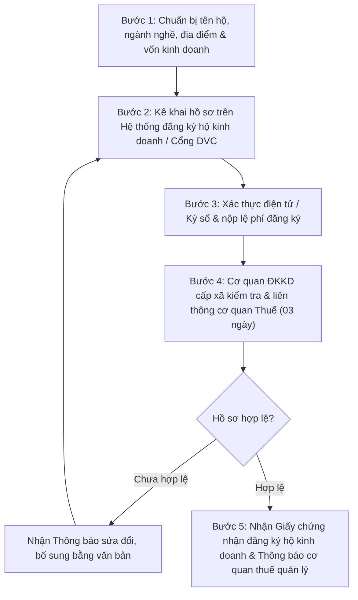

# Đăng ký thành lập hộ kinh doanh

## Thông tin nhanh

| Hạng mục | Chi tiết |
|---|---|
| **Mã thủ tục** | `1.001612` (chi tiết `2350`) |
| **Cơ quan chủ quản** | Bộ Tài chính — thực hiện tại Cơ quan đăng ký kinh doanh cấp xã |
| **Thời hạn giải quyết** | **03 ngày làm việc** kể từ ngày nhận đủ hồ sơ hợp lệ |
| **Biểu mẫu chính** | Biểu mẫu ban hành kèm Thông tư `68/2025/TT-BTC` |

## Sơ đồ quy trình

## Các bước thực hiện ngắn gọn

1. **Bước 1 — Chuẩn bị thông tin**: Xác định tên hộ kinh doanh, địa chỉ trụ sở, ngành nghề kinh doanh, số vốn và thông tin chủ hộ/các thành viên hộ gia đình.
2. **Bước 2 — Nộp hồ sơ**: Nộp trực tuyến qua hệ thống thông tin đăng ký hộ kinh doanh trên [Cổng thông tin quốc gia về đăng ký doanh nghiệp](https://dangkykinhdoanh.gov.vn/) (ký bằng chữ ký số hoặc xác thực điện tử), hoặc nộp trực tiếp tại Bộ phận tiếp nhận cấp xã.
3. **Bước 3 — Nộp lệ phí**: Thanh toán lệ phí đăng ký theo mức quy định của HĐND tỉnh/thành phố (trực tuyến qua Cổng DVC Quốc gia hoặc chuyển khoản/trực tiếp).
4. **Bước 4 — Thẩm định & liên thông thuế**: Trong **03 ngày làm việc**, cơ quan ĐKKD cấp xã kiểm tra hồ sơ và liên thông dữ liệu với hệ thống thuế.
5. **Bước 5 — Nhận kết quả**: Nhận **Giấy chứng nhận đăng ký hộ kinh doanh** kèm **Thông báo về cơ quan thuế quản lý trực tiếp**.

## Hồ sơ & biểu mẫu cần chuẩn bị

- **Giấy đề nghị đăng ký hộ kinh doanh** (theo mẫu Thông tư 68/2025/TT-BTC).
- **Xác thực điện tử (VNeID)** hoặc bản sao Thẻ Căn cước/CCCD còn hiệu lực nếu chưa có tài khoản định danh điện tử.
- **Văn bản ủy quyền có công chứng/chứng thực** của các thành viên hộ gia đình cho một thành viên làm chủ hộ (trường hợp hộ gia đình cùng đăng ký).

## Liên kết trang gốc & nộp hồ sơ trực tuyến

- [Chi tiết thủ tục & cơ sở pháp lý (`1.001612` / `2350`) — Cổng DVC Quốc gia](https://vpcp.dichvucong.gov.vn/p/home/dvc-tthc-thu-tuc-hanh-chinh-chi-tiet.html?ma_thu_tuc=2350)
- [Chi tiết thủ tục ngành dọc (`1.001612`)](https://vpcp.dichvucong.gov.vn/p/home/dvc-chi-tiet-thu-tuc-nganh-doc.html?ma_thu_tuc=1.001612)
- [Cổng Thông tin quốc gia về đăng ký doanh nghiệp](https://dangkykinhdoanh.gov.vn/)

## Căn cứ pháp lý

- Luật Doanh nghiệp `59/2020/QH14` và Luật sửa đổi `76/2025/QH15`
- Nghị định `168/2025/NĐ-CP` (ngày 30/06/2025) về đăng ký doanh nghiệp
- Thông tư `68/2025/TT-BTC` (ngày 01/07/2025) ban hành biểu mẫu đăng ký doanh nghiệp, hộ kinh doanh
