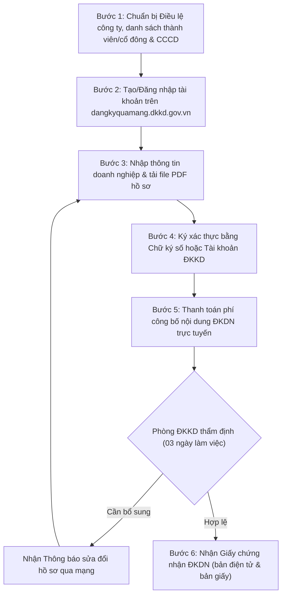

# Đăng ký thành lập doanh nghiệp qua mạng điện tử

## Thông tin nhanh

| Hạng mục | Chi tiết |
|---|---|
| **Mã thủ tục** | `2.001610` (và các thủ tục thành lập theo loại hình doanh nghiệp) |
| **Cơ quan chủ quản** | Bộ Tài chính — Phòng Đăng ký kinh doanh cấp tỉnh |
| **Thời hạn giải quyết** | **03 ngày làm việc** kể từ ngày nhận hồ sơ hợp lệ |
| **Ưu đãi trực tuyến** | **Miễn lệ phí đăng ký doanh nghiệp** khi nộp hồ sơ qua mạng điện tử |

## Sơ đồ quy trình

## Các bước thực hiện ngắn gọn

1. **Bước 1 — Tra cứu tên & chuẩn bị hồ sơ**: Tra cứu trùng tên doanh nghiệp trên [dangkykinhdoanh.gov.vn](https://dangkykinhdoanh.gov.vn/), soạn thảo Giấy đề nghị đăng ký, Điều lệ công ty và danh sách thành viên/cổ đông (định dạng PDF).
2. **Bước 2 — Đăng nhập Cổng đăng ký qua mạng**: Truy cập [dangkyquamang.dkkd.gov.vn](https://dangkyquamang.dkkd.gov.vn/) bằng tài khoản Đăng ký kinh doanh hoặc VNeID.
3. **Bước 3 — Tạo hồ sơ & đính kèm tài liệu**: Khai báo đầy đủ thông tin tên, địa chỉ, ngành nghề mã cấp 4, vốn điều lệ, người đại diện theo pháp luật và tải các file hồ sơ lên hệ thống.
4. **Bước 4 — Ký xác thực & nộp phí công bố**: Ký xác thực hồ sơ bằng Chữ ký số công cộng hoặc Tài khoản đăng ký kinh doanh, sau đó thanh toán phí công bố nội dung đăng ký doanh nghiệp trực tuyến (miễn lệ phí đăng ký).
5. **Bước 5 — Nhận Giấy chứng nhận ĐKDN**: Sau **03 ngày làm việc**, nếu hợp lệ sẽ nhận Giấy chứng nhận đăng ký doanh nghiệp (đồng thời là Mã số thuế) và tiến hành khắc dấu, đăng ký hóa đơn điện tử.

## Hồ sơ & biểu mẫu cần chuẩn bị

- **Giấy đề nghị đăng ký doanh nghiệp** (theo loại hình: Doanh nghiệp tư nhân, TNHH 1TV/2TV, Cổ phần).
- **Điều lệ công ty** (đối với công ty TNHH, Cổ phần, Hợp danh).
- **Danh sách thành viên / Danh sách cổ đông sáng lập** (tùy loại hình).
- **Bản sao giấy tờ pháp lý của cá nhân** (CCCD/Hộ chiếu) và **Văn bản ủy quyền** (nếu người nộp hồ sơ không phải người đại diện theo pháp luật — không bắt buộc công chứng).

## Liên kết trang gốc & nộp hồ sơ trực tuyến

- [Nộp hồ sơ trực tuyến tại Hệ thống Đăng ký doanh nghiệp qua mạng](https://dangkyquamang.dkkd.gov.vn/)
- [Hướng dẫn sử dụng dịch vụ công qua mạng điện tử](https://dangkykinhdoanh.gov.vn/vn/Pages/Huongdansudungdvc.aspx)
- [Chi tiết thủ tục trên Cổng Dịch vụ công Quốc gia (`2.001610`)](https://vpcp.dichvucong.gov.vn/p/home/dvc-chi-tiet-thu-tuc-nganh-doc.html?ma_thu_tuc=2.001610)
