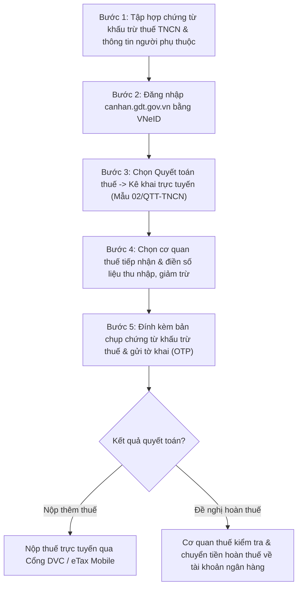

# Khai, nộp và quyết toán thuế thu nhập cá nhân trực tuyến

## Thông tin nhanh

| Hạng mục | Chi tiết |
|---|---|
| **Cơ quan thực hiện** | Cơ quan Thuế (Bộ Tài chính) |
| **Cổng nộp trực tuyến** | `canhan.gdt.gov.vn`, `thuedientu.gdt.gov.vn`, ứng dụng **eTax Mobile** |
| **Lệ phí** | **Miễn phí** thực hiện thủ tục kê khai |
| **Đăng nhập** | Tài khoản Định danh điện tử (**VNeID**) hoặc tài khoản Thuế điện tử |

## Sơ đồ quy trình

## Các bước thực hiện ngắn gọn

1. **Bước 1 — Chuẩn bị chứng từ**: Xin **Chứng từ khấu trừ thuế TNCN** (bản điện tử PDF/XML hoặc bản giấy) và Thư xác nhận thu nhập từ tất cả các đơn vị chi trả thu nhập trong năm.
2. **Bước 2 — Đăng nhập Cổng Thuế cá nhân**: Truy cập [canhan.gdt.gov.vn](https://canhan.gdt.gov.vn) (hoặc mục [Khai và nộp thuế cá nhân trên Cổng DVC Quốc gia](https://vpcp.dichvucong.gov.vn/p/home/dvc-thanh-toan-thue-ca-nhan.html)), chọn **Đăng nhập bằng tài khoản Định danh điện tử (VNeID)**.
3. **Bước 3 — Lập tờ khai 02/QTT-TNCN**: Vào mục **Quyết toán thuế** → **Kê khai trực tuyến**, chọn mẫu **02/QTT-TNCN**, kiểm tra thu nhập chịu thuế, bảo hiểm bắt buộc, giảm trừ gia cảnh bản thân và người phụ thuộc.
4. **Bước 4 — Đính kèm phụ lục & nộp tờ khai**: Đính kèm ảnh/PDF các chứng từ khấu trừ thuế, nhập mã xác thực OTP gửi về điện thoại để hoàn tất nộp tờ khai.
5. **Bước 5 — Nộp thuế hoặc nhận tiền hoàn thuế**: Nếu phát sinh số thuế nộp thêm, thanh toán ngay qua Cổng DVC/eTax Mobile. Nếu có số thuế nộp thừa, điền đúng số tài khoản ngân hàng chính chủ để nhận tiền hoàn thuế.

## Hồ sơ & biểu mẫu cần chuẩn bị

- **Tờ khai quyết toán thuế TNCN (Mẫu 02/QTT-TNCN)** (khai trực tuyến).
- **Phụ lục bảng kê giảm trừ gia cảnh cho người phụ thuộc** (nếu có).
- **Bản chụp/file điện tử Chứng từ khấu trừ thuế TNCN** của các công ty trong năm.
- **Số tài khoản ngân hàng chính chủ** (nếu đề nghị hoàn thuế).

## Liên kết trang gốc & nộp hồ sơ trực tuyến

- [Khai và nộp thuế cá nhân — Cổng Dịch vụ công Quốc gia](https://vpcp.dichvucong.gov.vn/p/home/dvc-thanh-toan-thue-ca-nhan.html)
- [Cổng Thuế điện tử dành cho Cá nhân (`canhan.gdt.gov.vn`)](https://canhan.gdt.gov.vn)
- [Cổng Thuế điện tử (`thuedientu.gdt.gov.vn`)](https://thuedientu.gdt.gov.vn)
