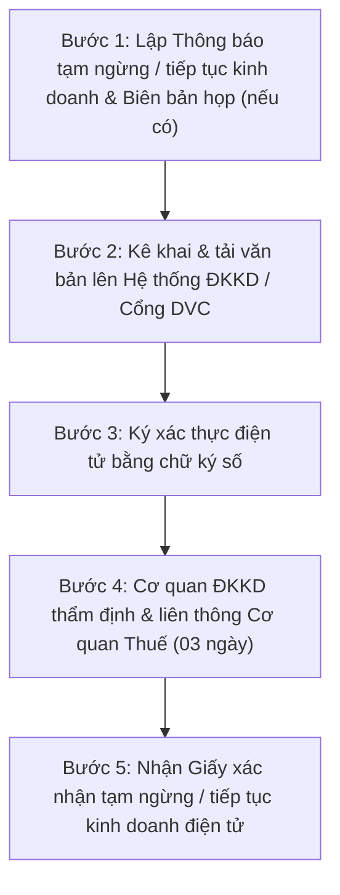

# Thông báo tạm ngừng kinh doanh / Tiếp tục kinh doanh trước thời hạn

## Thông tin nhanh

| Hạng mục | Chi tiết |
|---|---|
| **Mã thủ tục** | `1.001570` (Hộ kinh doanh) & `1.005377` (Hợp tác xã / Chi nhánh / VPĐD) |
| **Thời hạn giải quyết** | **03 ngày làm việc** kể từ ngày nhận đủ hồ sơ hợp lệ |
| **Hình thức nộp** | Trực tuyến qua Hệ thống đăng ký kinh doanh (ký số) hoặc trực tiếp |

## Sơ đồ quy trình

## Các bước thực hiện ngắn gọn

1. **Bước 1 — Chuẩn bị thông báo**: Soạn Thông báo về việc tạm ngừng kinh doanh (khi tạm ngừng từ 30 ngày trở lên) hoặc tiếp tục kinh doanh trước thời hạn; kèm bản sao biên bản họp thành viên (nếu hộ gia đình/tổ chức).
2. **Bước 2 — Nộp hồ sơ trực tuyến**: Đăng nhập [dangkyquamang.dkkd.gov.vn](https://dangkyquamang.dkkd.gov.vn/) hoặc Cổng DVC, tải văn bản điện tử và ký xác thực bằng chữ ký số.
3. **Bước 3 — Nhận Giấy xác nhận**: Trong **03 ngày làm việc**, cơ quan ĐKKD cấp Giấy xác nhận qua mạng điện tử.

## Hồ sơ & biểu mẫu cần chuẩn bị

- **Thông báo về việc tạm ngừng kinh doanh / tiếp tục kinh doanh trước thời hạn**.
- **Bản sao biên bản họp thành viên hộ gia đình** (đối với hộ kinh doanh do các thành viên hộ gia đình đăng ký) hoặc nghị quyết/quyết định của chủ sở hữu/HĐTV/HĐQT.

## Liên kết trang gốc & nộp hồ sơ trực tuyến

- [Thủ tục Tạm ngừng kinh doanh hộ kinh doanh (`1.001570`) — Cổng DVC Quốc gia](https://vpcp.dichvucong.gov.vn/p/home/dvc-chi-tiet-thu-tuc-dung-chung.html?ma_thu_tuc=1.001570)
- [Thủ tục Thông báo tạm ngừng HTX, chi nhánh, VPĐD (`1.005377`)](https://vpcp.dichvucong.gov.vn/p/home/dvc-chi-tiet-thu-tuc-hanh-chinh.html?ma_thu_tuc=1.005377)
- [Nộp hồ sơ trực tuyến trên Hệ thống ĐKKD qua mạng](https://dangkyquamang.dkkd.gov.vn/)
