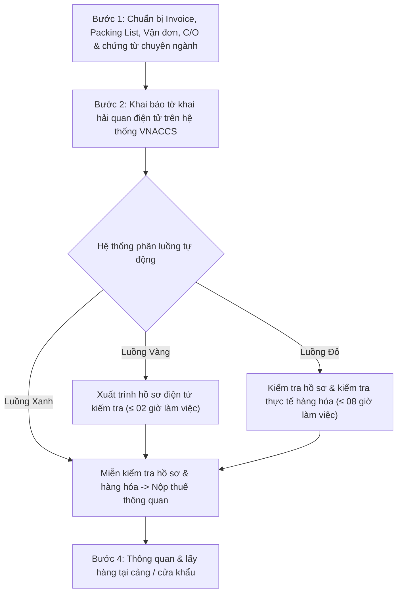

# Thủ tục hải quan đối với hàng hóa nhập khẩu

## Thông tin nhanh

| Hạng mục | Chi tiết |
|---|---|
| **Mã thủ tục** | `1.006440` |
| **Lệ phí hải quan** | **20.000 đồng** / tờ khai |
| **Thời hạn giải quyết** | Kiểm tra hồ sơ **≤ 02 giờ làm việc**; kiểm tra thực tế hàng hóa **≤ 08 giờ làm việc** (Khoản 2 Điều 23 Luật Hải quan) |

## Sơ đồ quy trình

## Các bước thực hiện ngắn gọn

1. **Bước 1 — Chuẩn bị bộ chứng từ**: Tập hợp Hợp đồng thương mại, Hóa đơn thương mại (Invoice), Phiếu đóng gói (Packing List), Vận đơn (B/L hoặc AWB), C/O và giấy phép kiểm tra chuyên ngành (nếu có).
2. **Bước 2 — Khai tờ khai điện tử**: Doanh nghiệp khai báo hải quan điện tử, đính kèm hồ sơ và nộp lệ phí **20.000 đồng**.
3. **Bước 3 — Kiểm tra theo phân luồng**: Thực hiện thông quan ngay (luồng Xanh), xuất trình hồ sơ kiểm tra trong **02 giờ làm việc** (luồng Vàng) hoặc xuất trình hàng kiểm tra thực tế trong **08 giờ làm việc** (luồng Đỏ).
4. **Bước 4 — Hoàn thành nghĩa vụ thuế & thông quan**: Nộp thuế nhập khẩu/VAT điện tử và hoàn tất thủ tục nhận hàng.

## Hồ sơ & biểu mẫu cần chuẩn bị

- **Tờ khai hải quan nhập khẩu điện tử**.
- **Hóa đơn thương mại, Vận đơn, Chứng nhận xuất xứ (C/O)** (nếu hưởng thuế suất ưu đãi).
- **Giấy phép nhập khẩu / Kết quả kiểm tra chuyên ngành** (y tế, kiểm dịch, an toàn thực phẩm, chất lượng — nếu thuộc danh mục).

## Liên kết trang gốc & nộp hồ sơ trực tuyến

- [Chi tiết thủ tục Hải quan hàng hóa nhập khẩu (`1.006440`) — Cổng DVC Quốc gia](https://vpcp.dichvucong.gov.vn/p/home/dvc-chi-tiet-thu-tuc-nganh-doc.html?ma_thu_tuc=1.006440)
