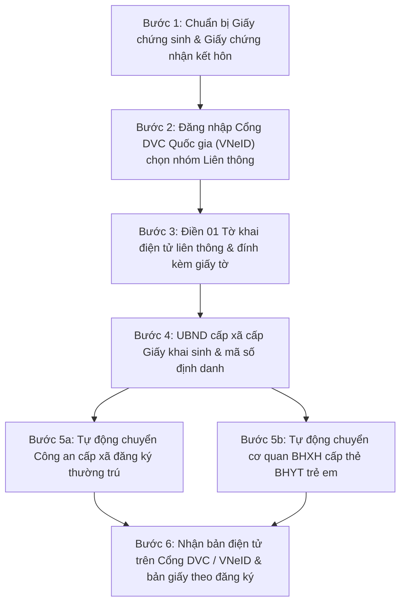

# Đăng ký khai sinh (và Liên thông Khai sinh - Thường trú - Thẻ BHYT)

## Thông tin nhanh

| Hạng mục | Chi tiết |
|---|---|
| **Mã thủ tục** | `1.001193` (Khai sinh) & `2.002621` (Liên thông 3 thủ tục) |
| **Cơ quan thực hiện** | UBND cấp xã, Công an cấp xã, Cơ quan BHXH |
| **Thời hạn giải quyết** | **Ngay trong ngày** (nếu nhận sau 15h trả ngày làm việc tiếp theo) đối với khai sinh |
| **Lệ phí** | **Miễn lệ phí** đối với đăng ký khai sinh đúng hạn, hộ nghèo, gia đình có công, người khuyết tật |

## Sơ đồ quy trình

## Các bước thực hiện ngắn gọn

1. **Bước 1 — Chuẩn bị giấy tờ**: Chụp/scan rõ nét **Giấy chứng sinh** do bệnh viện/cơ sở y tế cấp và thông tin Giấy chứng nhận kết hôn của cha mẹ (nếu đã kết hôn).
2. **Bước 2 — Nộp 01 hồ sơ liên thông**: Đăng nhập [Cổng Dịch vụ công Quốc gia](https://vpcp.dichvucong.gov.vn/p/home/dvc-chi-tiet-thu-tuc-hanh-chinh.html?ma_thu_tuc=2.002621) bằng VNeID, chọn nhóm thủ tục liên thông **Đăng ký khai sinh - Đăng ký thường trú - Cấp thẻ BHYT cho trẻ dưới 6 tuổi**.
3. **Bước 3 — Cấp Giấy khai sinh**: Công chức Tư pháp - Hộ tịch cấp xã tiếp nhận và giải quyết ngay trong ngày (nhận sau 15h trả trong ngày làm việc tiếp theo).
4. **Bước 4 — Liên thông tự động**: Hệ thống tự động chuyển dữ liệu sang Công an cấp xã để đăng ký thường trú và sang BHXH để cấp thẻ BHYT mà không cần nộp lại hồ sơ.
5. **Bước 5 — Nhận kết quả**: Nhận bản điện tử trực tiếp trên Cổng DVC/VNeID và nhận bản giấy tại Trung tâm Phục vụ hành chính công hoặc qua bưu điện.

## Hồ sơ & biểu mẫu cần chuẩn bị

- **Tờ khai đăng ký khai sinh điện tử** (hoặc Tờ khai liên thông trên Cổng DVC Quốc gia).
- **Giấy chứng sinh** bản chính (hoặc văn bản người làm chứng nếu sinh ngoài cơ sở y tế).
- **Thông tin/Bản chụp Giấy chứng nhận kết hôn** của cha, mẹ (trường hợp đã đăng ký kết hôn).
- Lưu ý: Ông, bà hoặc người thân thích đi khai sinh cho trẻ không cần văn bản ủy quyền của cha, mẹ nhưng phải thống nhất nội dung khai sinh.

## Liên kết trang gốc & nộp hồ sơ trực tuyến

- [Thủ tục đăng ký khai sinh (`1.001193`) — Cổng DVC Quốc gia](https://vpcp.dichvucong.gov.vn/p/home/dvc-chi-tiet-thu-tuc-dung-chung.html?ma_thu_tuc=1.001193)
- [Liên thông Đăng ký khai sinh - Thường trú - BHYT (`2.002621`)](https://vpcp.dichvucong.gov.vn/p/home/dvc-chi-tiet-thu-tuc-hanh-chinh.html?ma_thu_tuc=2.002621)
- [Nhóm sự kiện Có con nhỏ — Cổng DVC Quốc gia](https://vpcp.dichvucong.gov.vn/p/home/dvc-chi-tiet-nhom-su-kien-cho-cong-dan.html?group=750)
