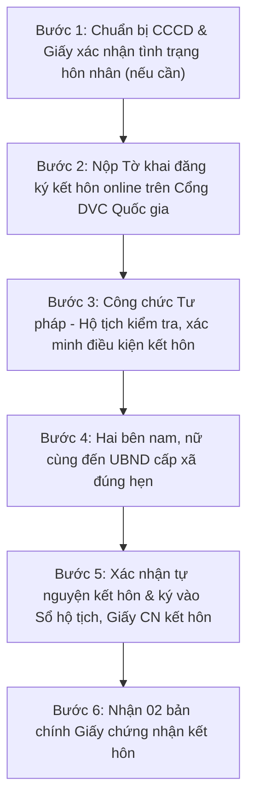

# Thủ tục đăng ký kết hôn

## Thông tin nhanh

| Hạng mục | Chi tiết |
|---|---|
| **Mã thủ tục** | `1.000894` (chi tiết `1325`) |
| **Cơ quan thực hiện** | UBND cấp xã nơi cư trú của một trong hai bên nam, nữ |
| **Hình thức nộp** | Nộp hồ sơ trực tuyến trước, sau đó **cả hai bên nam, nữ cùng có mặt** để ký vào Sổ hộ tịch |
| **Lệ phí** | Miễn lệ phí (công dân Việt Nam trong nước) |

## Sơ đồ quy trình

## Các bước thực hiện ngắn gọn

1. **Bước 1 — Chuẩn bị hồ sơ**: Chuẩn bị thẻ Căn cước/CCCD của cả hai bên; Giấy xác nhận tình trạng hôn nhân (chỉ cần nếu cơ quan hộ tịch không tự tra cứu được qua CSDL hộ tịch điện tử).
2. **Bước 2 — Khai & nộp trực tuyến**: Đăng nhập [Cổng Dịch vụ công Quốc gia](https://vpcp.dichvucong.gov.vn/p/home/dvc-chi-tiet-thu-tuc-dung-chung.html?ma_thu_tuc=1.000894), điền Tờ khai đăng ký kết hôn điện tử và đính kèm bản chụp giấy tờ.
3. **Bước 3 — Kiểm tra & hẹn ký sổ**: Cán bộ hộ tịch kiểm tra đủ điều kiện kết hôn theo Luật Hôn nhân và Gia đình và gửi thông báo lịch hẹn.
4. **Bước 4 — Ký sổ & nhận kết quả**: Cả hai bên nam, nữ **bắt buộc cùng có mặt** tại Trung tâm Phục vụ hành chính công/UBND cấp xã, xác nhận tự nguyện kết hôn, ký tên vào Sổ hộ tịch và nhận Giấy chứng nhận kết hôn.

## Hồ sơ & biểu mẫu cần chuẩn bị

- **Tờ khai đăng ký kết hôn** (theo mẫu chung hoặc điền trực tuyến trên Cổng DVC).
- **Giấy tờ tùy thân** (Căn cước/CCCD/Hộ chiếu còn giá trị) của cả hai bên để xuất trình khi ký sổ.
- **Giấy xác nhận tình trạng hôn nhân** (nếu không cùng nơi cư trú và hệ thống chưa đồng bộ dữ liệu hộ tịch).
- **Bản án/Quyết định ly hôn đã có hiệu lực** (nếu một trong hai bên đã từng kết hôn và ly hôn).

## Liên kết trang gốc & nộp hồ sơ trực tuyến

- [Chi tiết thủ tục đăng ký kết hôn (`1.000894`) — Cổng DVC Quốc gia](https://vpcp.dichvucong.gov.vn/p/home/dvc-chi-tiet-thu-tuc-dung-chung.html?ma_thu_tuc=1.000894)
- [Trang chi tiết & biểu mẫu (`1325`) — Cổng DVC Quốc gia](https://vpcp.dichvucong.gov.vn/p/home/dvc-tthc-thu-tuc-hanh-chinh-chi-tiet.html?ma_thu_tuc=1325)
