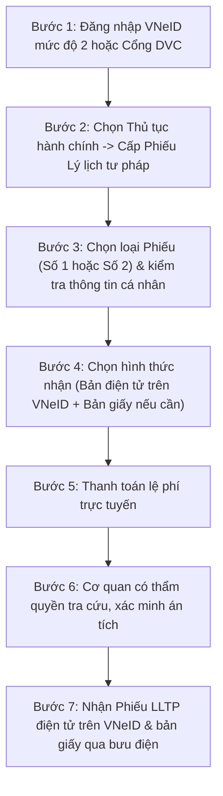

# Cấp Phiếu Lý lịch tư pháp (Số 1 và Số 2)

## Thông tin nhanh

| Hạng mục | Chi tiết |
|---|---|
| **Mã thủ tục** | `3.000333` & `2.000488` |
| **Hình thức nộp** | Trực tuyến toàn trình qua ứng dụng **VNeID mức 2** hoặc Cổng DVC |
| **Biểu mẫu chính** | Mẫu số `03/2024/LLTP`, `04/2024/LLTP`, `12/2024/LLTP` (Thông tư 06/2024/TT-BTP) |
| **Kết quả trả** | Bản điện tử (ký số, giá trị pháp lý tương đương bản giấy) trên VNeID và/hoặc bản giấy |

## Sơ đồ quy trình

## Các bước thực hiện ngắn gọn

1. **Bước 1 — Đăng nhập VNeID mức 2**: Mở ứng dụng VNeID (đã định danh mức độ 2) hoặc đăng nhập qua [Cổng Dịch vụ công Quốc gia](https://vpcp.dichvucong.gov.vn/p/home/dvc-chi-tiet-thu-tuc-nganh-doc.html?ma_thu_tuc=3.000333).
2. **Bước 2 — Tạo yêu cầu mới**: Vào mục **Thủ tục hành chính** → **Cấp Phiếu Lý lịch tư pháp** → **Tạo mới yêu cầu**.
3. **Bước 3 — Chọn loại Phiếu & khai báo**:
   - **Phiếu số 1**: Dùng cho xin việc, bổ sung hồ sơ cá nhân (có thể ủy quyền).
   - **Phiếu số 2**: Dùng cho hồ sơ du học, định cư, xin visa (chỉ cá nhân tự yêu cầu, không được ủy quyền).
4. **Bước 4 — Thanh toán lệ phí**: Nộp lệ phí trực tuyến theo hướng dẫn (có áp dụng miễn/giảm cho sinh viên, người có công nếu đính kèm giấy tờ chứng minh).
5. **Bước 5 — Nhận kết quả**: Theo dõi trạng thái ngay trên VNeID. Phiếu Lý lịch tư pháp bản điện tử được trả thẳng về ứng dụng VNeID để sử dụng nhiều lần.

## Hồ sơ & biểu mẫu cần chuẩn bị

- **Tờ khai yêu cầu cấp Phiếu lý lịch tư pháp** theo Thông tư `06/2024/TT-BTP` (tự động điền khi nộp qua VNeID).
- **Tài khoản VNeID mức độ 2** (hoặc bản chụp CCCD/Hộ chiếu nếu nộp trực tiếp/bưu chính).
- **Giấy tờ chứng minh thuộc diện miễn/giảm phí** (Thẻ sinh viên, giấy xác nhận hộ nghèo... nếu có).

## Liên kết trang gốc & nộp hồ sơ trực tuyến

- [Chi tiết thủ tục ngành dọc (`3.000333`) — Cổng DVC Quốc gia](https://vpcp.dichvucong.gov.vn/p/home/dvc-chi-tiet-thu-tuc-nganh-doc.html?ma_thu_tuc=3.000333)
- [Chi tiết hồ sơ & tải mẫu Thông tư 06/2024/TT-BTP (`2.000488`)](https://vpcp.dichvucong.gov.vn/p/home/dvc-chi-tiet-thu-tuc-hanh-chinh.html?ma_thu_tuc=2.000488)
