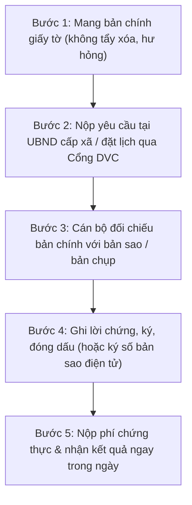

# Chứng thực bản sao từ bản chính giấy tờ, văn bản

## Thông tin nhanh

| Hạng mục | Chi tiết |
|---|---|
| **Mã thủ tục** | `2.000815` (chi tiết `2630`) |
| **Cơ quan thực hiện** | UBND cấp xã, Phòng Tư pháp, Văn phòng công chứng |
| **Thời hạn giải quyết** | **Trong ngày** (nhận sau 15h trả ngày làm việc tiếp theo; số lượng lớn tối đa thêm 02 ngày) |
| **Căn cứ mới** | Nghị định 23/2015/NĐ-CP sửa đổi bởi Nghị định `07/2025/NĐ-CP` |

## Sơ đồ quy trình

## Các bước thực hiện ngắn gọn

1. **Bước 1 — Chuẩn bị bản chính**: Chuẩn bị bản chính giấy tờ hợp lệ (không bị tẩy xóa, hư hỏng nặng, không đóng dấu mật).
2. **Bước 2 — Nộp yêu cầu chứng thực**: Đến UBND cấp xã/Trung tâm Phục vụ HCC (có thể đặt lịch trước trên [Cổng Dịch vụ công Quốc gia](https://vpcp.dichvucong.gov.vn/p/home/dvc-cap-ban-sao-tu-ban-chinh.html?ma_thu_tuc=2.000815)) và xuất trình bản chính.
3. **Bước 3 — Đối chiếu & ký chứng thực**: Cán bộ đối chiếu bản sao, ghi lời chứng, ký đóng dấu (hoặc ký số tạo bản sao điện tử gửi thẳng vào Kho dữ liệu cá nhân trên Cổng DVC).
4. **Bước 4 — Nhận kết quả**: Nộp lệ phí và nhận kết quả ngay trong ngày (nhận sau 15h trả trong ngày làm việc tiếp theo).

## Hồ sơ & biểu mẫu cần chuẩn bị

- **Bản chính giấy tờ, văn bản** cần chứng thực.
- **Bản sao cần chứng thực** (nếu không mang bản sao, cơ quan thực hiện chụp từ bản chính nếu có phương tiện).

## Liên kết trang gốc & nộp hồ sơ trực tuyến

- [Chi tiết thủ tục Chứng thực bản sao từ bản chính (`2.000815`)](https://vpcp.dichvucong.gov.vn/p/home/dvc-cap-ban-sao-tu-ban-chinh.html?ma_thu_tuc=2.000815)
- [Chi tiết căn cứ pháp lý Nghị định 07/2025/NĐ-CP (`2630`)](https://vpcp.dichvucong.gov.vn/p/home/dvc-tthc-thu-tuc-hanh-chinh-chi-tiet.html?ma_thu_tuc=2630)
