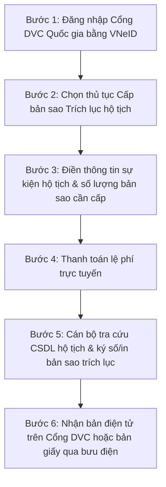

# Cấp bản sao Trích lục hộ tịch, bản sao Giấy khai sinh

## Thông tin nhanh

| Hạng mục | Chi tiết |
|---|---|
| **Mã thủ tục** | `1943` |
| **Cơ quan thực hiện** | UBND cấp xã hoặc cơ quan quản lý Cơ sở dữ liệu hộ tịch |
| **Hình thức nộp** | Trực tuyến trên Cổng DVC Quốc gia, trực tiếp hoặc bưu chính |

## Sơ đồ quy trình

## Các bước thực hiện ngắn gọn

1. **Bước 1 — Đăng nhập Cổng DVC**: Truy cập [Cổng Dịch vụ công Quốc gia (`1943`)](https://vpcp.dichvucong.gov.vn/p/home/dvc-tthc-thu-tuc-hanh-chinh-chi-tiet.html?ma_thu_tuc=1943) bằng tài khoản VNeID.
2. **Bước 2 — Khai tờ khai yêu cầu**: Nhập thông tin loại trích lục cần cấp (khai sinh, kết hôn, khai tử...), số lượng bản và chọn nhận bản điện tử/bản giấy.
3. **Bước 3 — Thanh toán lệ phí**: Nộp lệ phí cấp bản sao trực tuyến theo thông báo.
4. **Bước 4 — Nhận bản sao trích lục**: Nhận bản sao trích lục hộ tịch điện tử (ký số) hoặc bản giấy tại cơ quan tiếp nhận/qua bưu điện.

## Hồ sơ & biểu mẫu cần chuẩn bị

- **Tờ khai cấp bản sao trích lục hộ tịch** (điền trực tuyến).
- **Giấy tờ tùy thân** (CCCD/Hộ chiếu) và giấy tờ chứng minh quan hệ (nếu xin cấp thay).

## Liên kết trang gốc & nộp hồ sơ trực tuyến

- [Chi tiết thủ tục & nộp hồ sơ trực tuyến (`1943`) — Cổng DVC Quốc gia](https://vpcp.dichvucong.gov.vn/p/home/dvc-tthc-thu-tuc-hanh-chinh-chi-tiet.html?ma_thu_tuc=1943)
