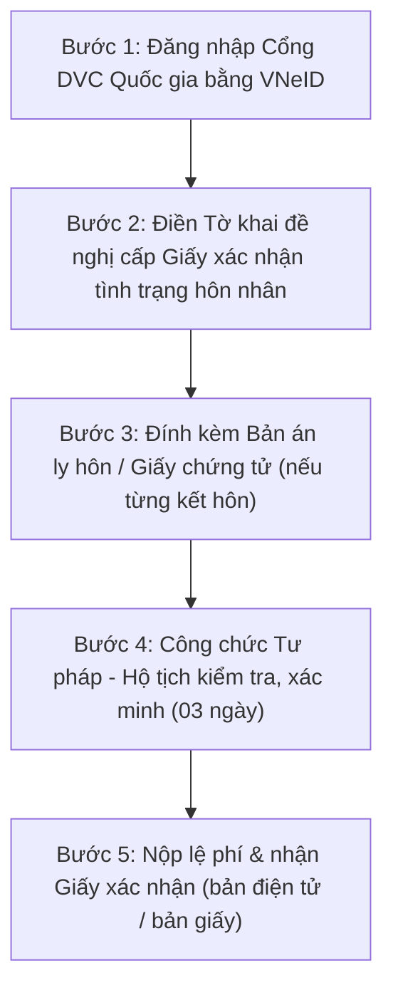

# Cấp Giấy xác nhận tình trạng hôn nhân

## Thông tin nhanh

| Hạng mục | Chi tiết |
|---|---|
| **Mã thủ tục** | `6807` |
| **Cơ quan thực hiện** | UBND cấp xã nơi công dân thường trú |
| **Thời hạn giải quyết** | **03 ngày làm việc** kể từ ngày nhận đủ hồ sơ hợp lệ |

## Sơ đồ quy trình

## Các bước thực hiện ngắn gọn

1. **Bước 1 — Kê khai trực tuyến**: Truy cập [Cổng Dịch vụ công Quốc gia (`6807`)](https://vpcp.dichvucong.gov.vn/p/home/dvc-tthc-thu-tuc-hanh-chinh-chi-tiet.html?ma_thu_tuc=6807), điền Tờ khai và nêu rõ mục đích sử dụng (kết hôn, giao dịch dân sự...).
2. **Bước 2 — Đính kèm giấy tờ liên quan**: Nếu đã từng kết hôn nhưng đã ly hôn hoặc vợ/chồng đã chết, cung cấp thông tin/bản chụp Bản án ly hôn đã có hiệu lực hoặc Trích lục khai tử.
3. **Bước 3 — Xác minh & trả kết quả**: Trong **03 ngày làm việc**, UBND cấp xã kiểm tra dữ liệu hộ tịch và cấp Giấy xác nhận tình trạng hôn nhân.

## Hồ sơ & biểu mẫu cần chuẩn bị

- **Tờ khai cấp Giấy xác nhận tình trạng hôn nhân** (khai trực tuyến).
- **Thông tin/bản sao Bản án ly hôn hoặc Trích lục khai tử** (nếu thuộc trường hợp đã chấm dứt hôn nhân trước đó).

## Liên kết trang gốc & nộp hồ sơ trực tuyến

- [Chi tiết thủ tục & nộp trực tuyến (`6807`) — Cổng DVC Quốc gia](https://vpcp.dichvucong.gov.vn/p/home/dvc-tthc-thu-tuc-hanh-chinh-chi-tiet.html?ma_thu_tuc=6807)
