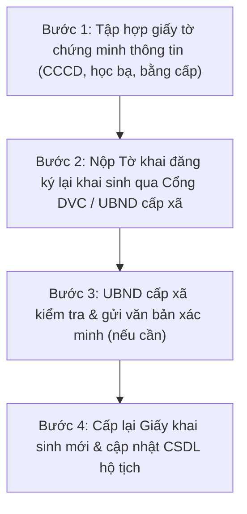

# Thủ tục đăng ký lại khai sinh

## Thông tin nhanh

| Hạng mục | Chi tiết |
|---|---|
| **Mã thủ tục** | `6823` |
| **Cơ quan thực hiện** | UBND cấp xã nơi đã đăng ký trước đây hoặc nơi thường trú hiện tại |
| **Điều kiện** | Đã đăng ký khai sinh trước 01/01/2016 nhưng Sổ hộ tịch và bản chính đều bị mất |

## Sơ đồ quy trình

## Các bước thực hiện ngắn gọn

1. **Bước 1 — Chuẩn bị giấy tờ chứng minh**: Chuẩn bị bản sao các giấy tờ có ghi thông tin cá nhân khớp nhau (CCCD, hộ chiếu, bằng tốt nghiệp, học bạ, sổ BHXH...).
2. **Bước 2 — Nộp hồ sơ**: Nộp trực tuyến qua [Cổng Dịch vụ công Quốc gia (`6823`)](https://vpcp.dichvucong.gov.vn/p/home/dvc-tthc-thu-tuc-hanh-chinh-chi-tiet.html?ma_thu_tuc=6823) hoặc trực tiếp tại UBND cấp xã.
3. **Bước 3 — Xác minh & nhận kết quả**: Cơ quan hộ tịch kiểm tra, xác minh (nếu đăng ký tại nơi khác nơi sinh cũ) và cấp Giấy khai sinh mới.

## Hồ sơ & biểu mẫu cần chuẩn bị

- **Tờ khai đăng ký lại khai sinh** (theo mẫu).
- **Bản sao toàn bộ hồ sơ, giấy tờ có thông tin cá nhân**: CCCD, bằng tốt nghiệp, học bạ, giấy tờ chứng minh nơi cư trú...

## Liên kết trang gốc & nộp hồ sơ trực tuyến

- [Chi tiết thủ tục Đăng ký lại khai sinh (`6823`) — Cổng DVC Quốc gia](https://vpcp.dichvucong.gov.vn/p/home/dvc-tthc-thu-tuc-hanh-chinh-chi-tiet.html?ma_thu_tuc=6823)
