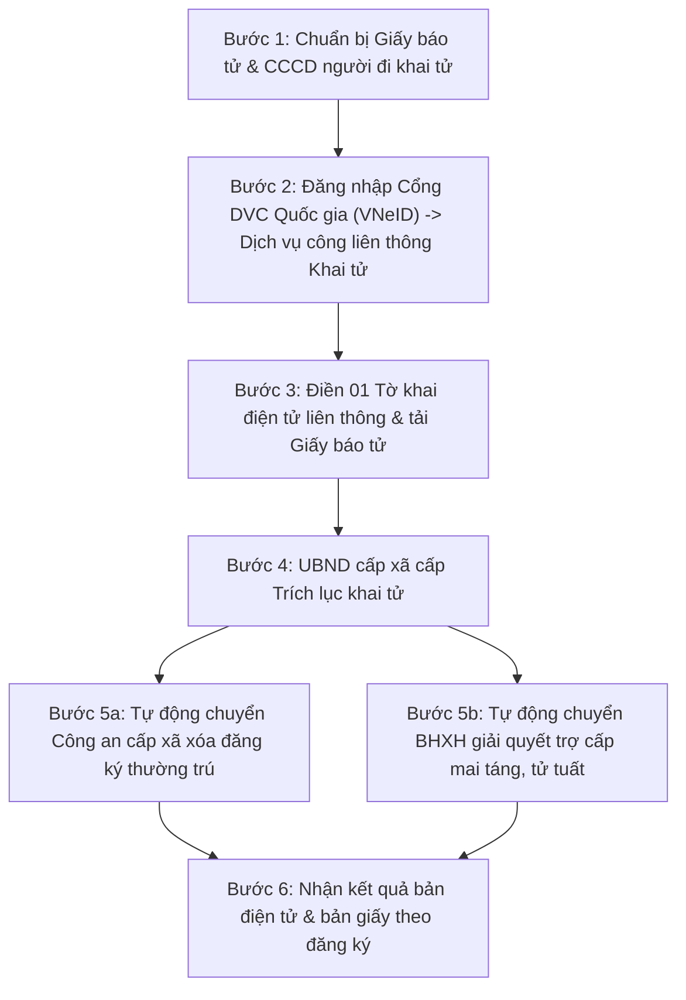

# Đăng ký khai tử & Liên thông Xóa đăng ký thường trú, Hỗ trợ mai táng phí

## Thông tin nhanh

| Hạng mục | Chi tiết |
|---|---|
| **Nhóm thủ tục** | Dịch vụ công liên thông Khai tử (`group=759`, chi tiết `118800`) |
| **Cơ quan phối hợp** | UBND cấp xã, Công an cấp xã, Cơ quan BHXH / Phòng LĐTB&XH |
| **Lệ phí** | **Miễn lệ phí** đăng ký khai tử đúng hạn |

## Sơ đồ quy trình

## Các bước thực hiện ngắn gọn

1. **Bước 1 — Chuẩn bị Giấy báo tử**: Chuẩn bị Giấy báo tử do cơ sở y tế cấp (hoặc văn bản thay thế theo quy định) và thông tin sổ BHXH/tài khoản nhận trợ cấp mai táng của thân nhân (nếu thuộc diện hưởng).
2. **Bước 2 — Nộp 01 hồ sơ liên thông**: Đăng nhập [Cổng Dịch vụ công Quốc gia (Nhóm Người thân qua đời)](https://vpcp.dichvucong.gov.vn/p/home/dvc-chi-tiet-nhom-su-kien-cho-cong-dan.html?group=759) bằng VNeID, chọn mục **Dịch vụ công liên thông: Khai tử** và điền tờ khai điện tử.
3. **Bước 3 — Cấp Trích lục khai tử**: UBND cấp xã kiểm tra và cấp Trích lục khai tử, đồng thời hệ thống tự động chuyển dữ liệu sang Công an cấp xã để xóa đăng ký thường trú và sang BHXH để giải quyết mai táng phí/chế độ tử tuất.
4. **Bước 4 — Nhận kết quả**: Nhận Trích lục khai tử bản điện tử trên Cổng DVC/VNeID và bản giấy tại Trung tâm Phục vụ hành chính công.

## Hồ sơ & biểu mẫu cần chuẩn bị

- **Tờ khai điện tử liên thông đăng ký khai tử** (trên Cổng DVC Quốc gia).
- **Giấy báo tử** hoặc giấy tờ thay thế Giấy báo tử theo Luật Hộ tịch.
- **Thông tin tài khoản ngân hàng của thân nhân** (nếu yêu cầu hưởng trợ cấp mai táng / tử tuất).

## Liên kết trang gốc & nộp hồ sơ trực tuyến

- [Nhóm sự kiện Người thân qua đời (Khai tử & Chế độ tử tuất, mai táng phí)](https://vpcp.dichvucong.gov.vn/p/home/dvc-chi-tiet-nhom-su-kien-cho-cong-dan.html?group=759)
- [Chi tiết thủ tục hộ tịch khai tử (`118800`) — Cổng DVC Quốc gia](https://vpcp.dichvucong.gov.vn/p/home/dvc-tthc-thu-tuc-hanh-chinh-chi-tiet.html?ma_thu_tuc=118800)
