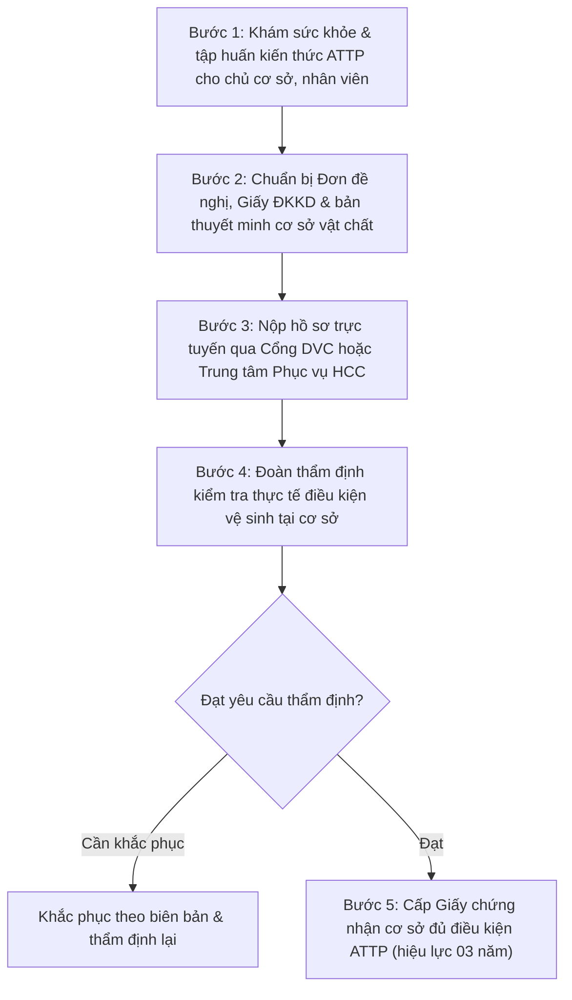

# Cấp Giấy chứng nhận cơ sở đủ điều kiện an toàn thực phẩm

## Thông tin nhanh

| Hạng mục | Chi tiết |
|---|---|
| **Mã thủ tục** | `6359` |
| **Cơ quan thực hiện** | Sở Y tế / Chi cục An toàn vệ sinh thực phẩm / Ban Quản lý ATTP (hoặc ngành Công Thương / NN&MT tùy nhóm sản phẩm) |
| **Thời hạn giải quyết** | **15 ngày làm việc** kể từ ngày nhận đủ hồ sơ hợp lệ |
| **Hiệu lực GCN** | **03 năm** kể từ ngày cấp |

## Sơ đồ quy trình

## Các bước thực hiện ngắn gọn

1. **Bước 1 — Chuẩn bị điều kiện nhân sự & cơ sở**: Chủ cơ sở và người trực tiếp chế biến thực hiện khám sức khỏe đủ điều kiện và có xác nhận kiến thức an toàn thực phẩm; bố trí bếp/khu chế biến theo nguyên tắc một chiều.
2. **Bước 2 — Nộp hồ sơ**: Nộp Đơn đề nghị, bản sao Giấy ĐKKD và Bản thuyết minh cơ sở vật chất qua [Cổng Dịch vụ công Quốc gia (`6359`)](https://vpcp.dichvucong.gov.vn/p/home/dvc-tthc-thu-tuc-hanh-chinh-chi-tiet.html?ma_thu_tuc=6359) hoặc Trung tâm Phục vụ hành chính công.
3. **Bước 3 — Thẩm định thực tế**: Trong vòng **15 ngày làm việc**, cơ quan quản lý cử đoàn kiểm tra thực tế tại cơ sở và lập biên bản.
4. **Bước 4 — Nhận Giấy chứng nhận**: Nếu đạt yêu cầu, nhận Giấy chứng nhận cơ sở đủ điều kiện an toàn thực phẩm (có giá trị 03 năm).

## Hồ sơ & biểu mẫu cần chuẩn bị

- **Đơn đề nghị cấp Giấy chứng nhận cơ sở đủ điều kiện an toàn thực phẩm**.
- **Bản sao Giấy chứng nhận đăng ký kinh doanh / hộ kinh doanh** có ngành nghề thực phẩm/ăn uống.
- **Bản thuyết minh về cơ sở vật chất, trang thiết bị, dụng cụ** bảo đảm điều kiện vệ sinh ATTP.
- **Giấy xác nhận đủ sức khỏe** và **danh sách người đã được tập huấn kiến thức ATTP** của chủ cơ sở và nhân viên.

## Liên kết trang gốc & nộp hồ sơ trực tuyến

- [Chi tiết thủ tục Cấp GCN cơ sở đủ điều kiện ATTP (`6359`) — Cổng DVC Quốc gia](https://vpcp.dichvucong.gov.vn/p/home/dvc-tthc-thu-tuc-hanh-chinh-chi-tiet.html?ma_thu_tuc=6359)
