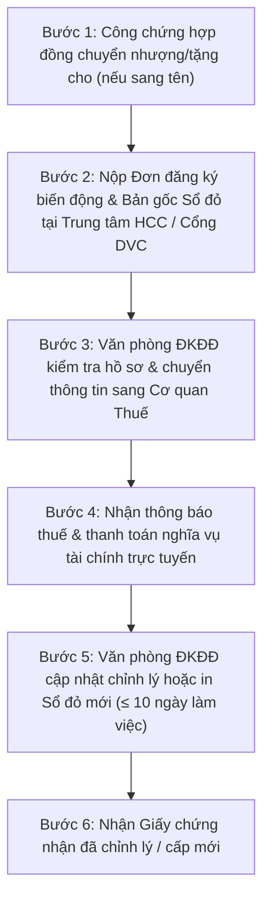

# Đăng ký biến động quyền sử dụng đất, cấp đổi Giấy chứng nhận (Sổ đỏ)

## Thông tin nhanh

| Hạng mục | Chi tiết |
|---|---|
| **Mã thủ tục** | `2.000410` (Đăng ký biến động) & `1.012783` (Cấp đổi Giấy chứng nhận) |
| **Cơ quan thực hiện** | Văn phòng Đăng ký đất đai / Chi nhánh VPĐKĐĐ / Trung tâm Phục vụ HCC |
| **Thời hạn giải quyết** | **10 ngày làm việc** kể từ ngày nhận đủ hồ sơ hợp lệ |
| **Biểu mẫu chính** | Đơn đăng ký biến động đất đai (**Mẫu số 09/ĐK** / **Mẫu số 18** theo Nghị định 151/2025/NĐ-CP) |

## Sơ đồ quy trình

## Các bước thực hiện ngắn gọn

1. **Bước 1 — Chuẩn bị hồ sơ pháp lý**: Chuẩn bị **Bản gốc Giấy chứng nhận (Sổ đỏ)** đã cấp và hợp đồng chuyển nhượng/tặng cho/văn bản thừa kế đã công chứng (nếu là sang tên) hoặc giấy tờ chứng minh thay đổi thông tin.
2. **Bước 2 — Nộp hồ sơ**: Nộp trực tuyến qua Cổng Dịch vụ công cấp tỉnh/Quốc gia hoặc nộp trực tiếp tại Trung tâm Phục vụ hành chính công / Văn phòng Đăng ký đất đai (bắt buộc nộp bản gốc Sổ đỏ để đối chiếu/thu hồi).
3. **Bước 3 — Xác định nghĩa vụ tài chính**: Văn phòng ĐKĐĐ chuyển phiếu chuyển thông tin địa chính sang Cơ quan Thuế để tính thuế thu nhập cá nhân và lệ phí trước bạ (nếu thuộc diện phải nộp).
4. **Bước 4 — Thanh toán trực tuyến**: Thanh toán nghĩa vụ tài chính qua chức năng **Thanh toán trực tuyến** trên Cổng Dịch vụ công Quốc gia bằng mã hồ sơ.
5. **Bước 5 — Nhận kết quả**: Nhận Sổ đỏ đã xác nhận biến động hoặc Sổ đỏ cấp đổi mới trong thời hạn **10 ngày làm việc**.

## Hồ sơ & biểu mẫu cần chuẩn bị

- **Đơn đăng ký biến động đất đai, tài sản gắn liền với đất** (Mẫu số `09/ĐK` hoặc Mẫu số `18` ban hành kèm Nghị định `151/2025/NĐ-CP`).
- **Bản gốc Giấy chứng nhận quyền sử dụng đất** đã cấp (01 bản chính).
- **Hợp đồng/văn bản về chuyển nhượng, tặng cho, thừa kế** đã công chứng, chứng thực (nếu đăng ký chuyển quyền).
- **Tờ khai thuế TNCN & lệ phí trước bạ** (trường hợp phát sinh nghĩa vụ tài chính).

## Liên kết trang gốc & nộp hồ sơ trực tuyến

- [Thủ tục Đăng ký biến động quyền sử dụng đất (`2.000410`) — Cổng DVC Quốc gia](https://vpcp.dichvucong.gov.vn/p/home/dvc-chi-tiet-thu-tuc-nganh-doc.html?ma_thu_tuc=2.000410)
- [Thủ tục Cấp đổi Giấy chứng nhận (`1.012783`, NĐ 151/2025/NĐ-CP) — Cổng DVC Quốc gia](https://vpcp.dichvucong.gov.vn/p/home/dvc-chi-tiet-thu-tuc-hanh-chinh.html?ma_thu_tuc=1.012783)
