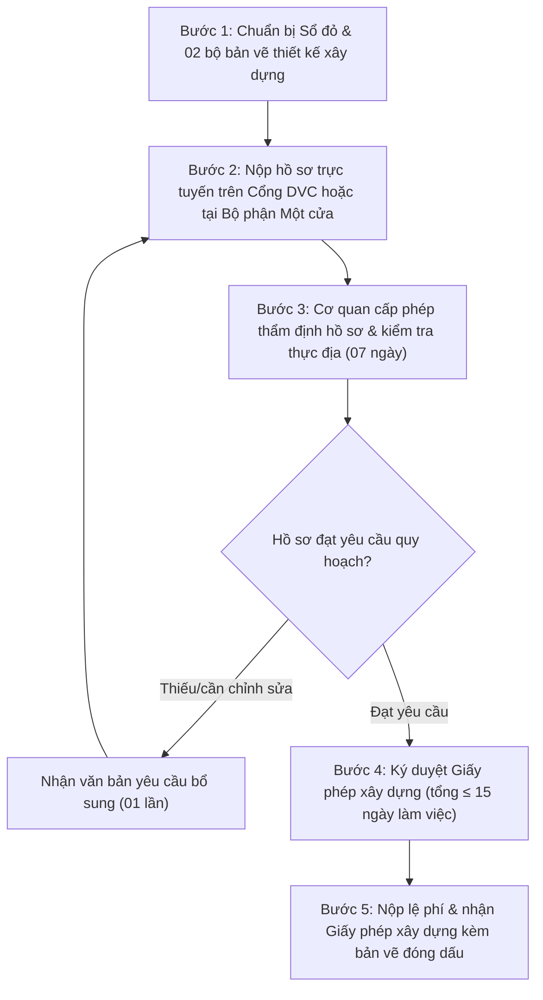

# Cấp giấy phép xây dựng đối với công trình, nhà ở riêng lẻ

## Thông tin nhanh

| Hạng mục | Chi tiết |
|---|---|
| **Mã thủ tục** | `1.004687` |
| **Cơ quan chủ quản** | Bộ Xây dựng — thực hiện tại UBND / Trung tâm Phục vụ hành chính công địa phương |
| **Thời hạn giải quyết** | **Không quá 15 ngày làm việc** kể từ ngày nhận đủ hồ sơ hợp lệ (nhà ở riêng lẻ) |
| **Số bộ hồ sơ** | 02 bộ bản vẽ thiết kế xây dựng + 01 bản chính Đơn đề nghị |

## Sơ đồ quy trình

## Các bước thực hiện ngắn gọn

1. **Bước 1 — Chuẩn bị hồ sơ thiết kế**: Chuẩn bị bản sao Giấy chứng nhận quyền sử dụng đất (Sổ đỏ) và **02 bộ bản vẽ thiết kế xây dựng** (mặt bằng, mặt đứng, mặt cắt, móng, sơ đồ đấu nối điện nước).
2. **Bước 2 — Nộp hồ sơ**: Nộp trực tuyến qua Cổng Dịch vụ công tỉnh/thành phố (liên kết từ [Cổng Dịch vụ công Quốc gia](https://vpcp.dichvucong.gov.vn/p/home/dvc-chi-tiet-thu-tuc-hanh-chinh.html?ma_thu_tuc=1.004687)) hoặc trực tiếp tại Bộ phận Một cửa.
3. **Bước 3 — Thẩm định & kiểm tra thực địa**: Trong vòng 07 ngày làm việc, cơ quan có thẩm quyền thẩm định hồ sơ và kiểm tra thực tế khu đất. Nếu cần bổ sung sẽ thông báo bằng văn bản.
4. **Bước 4 — Nộp lệ phí & nhận GPXD**: Đến ngày hẹn (không quá **15 ngày làm việc**), chủ đầu tư nộp lệ phí theo quy định địa phương và nhận Giấy phép xây dựng kèm hồ sơ thiết kế đã đóng dấu thẩm định.

## Hồ sơ & biểu mẫu cần chuẩn bị

- **Đơn đề nghị cấp giấy phép xây dựng** (theo mẫu quy định, 01 bản chính).
- **Bản sao giấy tờ chứng minh quyền sử dụng đất** theo quy định của pháp luật về đất đai.
- **02 bộ bản vẽ thiết kế xây dựng** (gồm bản vẽ mặt bằng công trình trên lô đất, mặt bằng các tầng, mặt đứng, mặt cắt chính, bản vẽ mặt bằng móng, sơ đồ đấu nối hạ tầng kỹ thuật).
- **Bản cam kết bảo đảm an toàn đối với công trình liền kề** (nếu xây dựng có công trình liền kề).

## Liên kết trang gốc & nộp hồ sơ trực tuyến

- [Chi tiết thủ tục cấp GPXD nhà ở riêng lẻ (`1.004687`) — Cổng DVC Quốc gia](https://vpcp.dichvucong.gov.vn/p/home/dvc-chi-tiet-thu-tuc-hanh-chinh.html?ma_thu_tuc=1.004687)
- [Nhóm dịch vụ Điện lực, Nhà ở, Đất đai — Cổng DVC Quốc gia](https://vpcp.dichvucong.gov.vn/p/home/dvc-chi-tiet-nhom-su-kien-cho-cong-dan.html?group=755)
