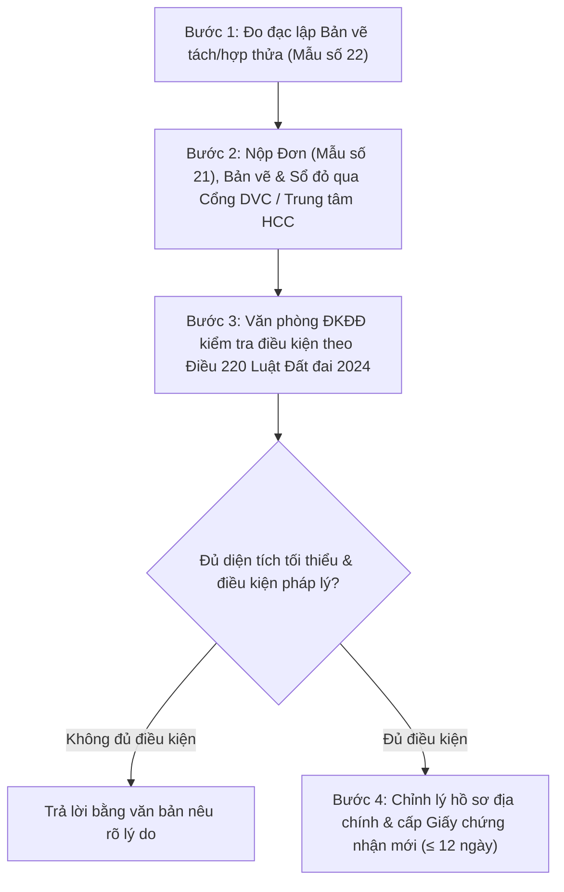

# Tách thửa hoặc hợp thửa đất

## Thông tin nhanh

| Hạng mục | Chi tiết |
|---|---|
| **Mã thủ tục** | `1.012784` (chi tiết `348171`, QĐ `2304/QĐ-BNNMT`) |
| **Cơ quan thực hiện** | Văn phòng Đăng ký đất đai / Chi nhánh VPĐKĐĐ |
| **Thời hạn giải quyết** | **Không quá 12 ngày làm việc** (22 ngày với vùng miền núi, hải đảo, đặc biệt khó khăn) |
| **Biểu mẫu chính** | Đơn đề nghị (**Mẫu số 21**) & Bản vẽ tách/hợp thửa (**Mẫu số 22**, Nghị định `151/2025/NĐ-CP`) |

## Sơ đồ quy trình

## Các bước thực hiện ngắn gọn

1. **Bước 1 — Đo đạc lập bản vẽ**: Liên hệ đơn vị đo đạc có giấy phép hoặc Văn phòng ĐKĐĐ lập **Bản vẽ tách thửa/hợp thửa đất (Mẫu số 22)**.
2. **Bước 2 — Nộp hồ sơ**: Nộp **Đơn đề nghị (Mẫu số 21)**, Bản vẽ Mẫu 22 và Giấy chứng nhận đã cấp trực tuyến trên Cổng DVC hoặc trực tiếp tại Trung tâm Phục vụ hành chính công / VPĐKĐĐ.
3. **Bước 3 — Kiểm tra điều kiện**: Văn phòng ĐKĐĐ đối chiếu diện tích tối thiểu, lối đi và quy hoạch theo Điều 220 Luật Đất đai `43/2024/QH15`.
4. **Bước 4 — Nhận Sổ đỏ mới**: Nộp phí, lệ phí theo thông báo và nhận các Giấy chứng nhận quyền sử dụng đất mới trong **12 ngày làm việc**.

## Hồ sơ & biểu mẫu cần chuẩn bị

- **Đơn đề nghị tách thửa đất, hợp thửa đất (Mẫu số 21)** ban hành kèm Nghị định `151/2025/NĐ-CP`.
- **Bản vẽ tách thửa đất, hợp thửa đất (Mẫu số 22)** ban hành kèm Nghị định `151/2025/NĐ-CP`.
- **Giấy chứng nhận đã cấp** (bản chính hoặc bản sao công chứng kèm bản gốc đối chiếu).

## Liên kết trang gốc & nộp hồ sơ trực tuyến

- [Chi tiết thủ tục Tách thửa hoặc hợp thửa đất (`1.012784`) — Cổng DVC Quốc gia](https://vpcp.dichvucong.gov.vn/p/home/dvc-chi-tiet-thu-tuc-dung-chung.html?ma_thu_tuc=1.012784)
- [Chi tiết hồ sơ & căn cứ pháp lý (`348171`) — Cổng DVC Quốc gia](https://vpcp.dichvucong.gov.vn/p/home/dvc-tthc-thu-tuc-hanh-chinh-chi-tiet.html?ma_thu_tuc=348171)
